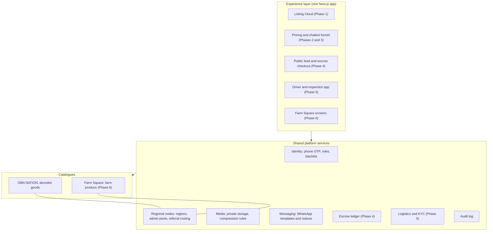
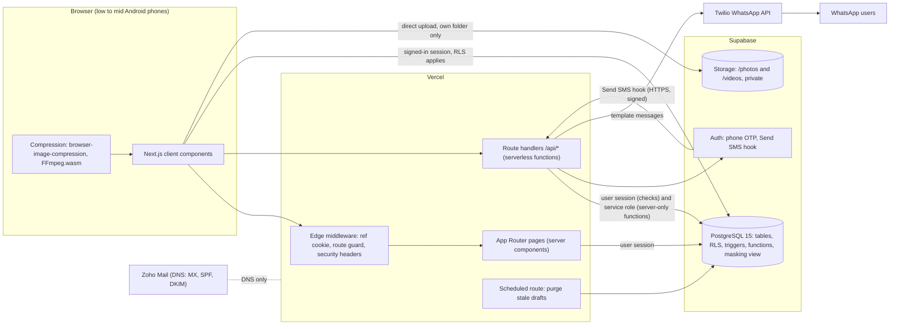
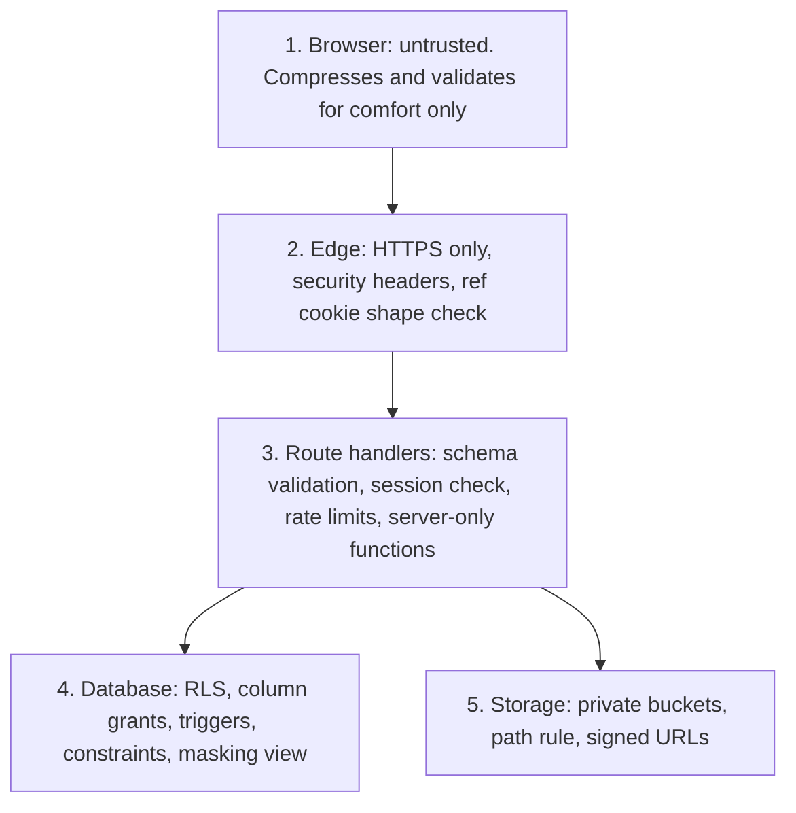

# 01 · System Architecture (ARD and Macro Overview)

Project: OBN NATION ONLINE.COM · Phase 1, the Listing Cloud
Owner: Ighodalo Labs · Developer: Bassey · Version 1.0 · 17 Oct 2026
Related: [02 PRD](02_PRD_PHASE_1.md) · [03 Database](03_ERD_AND_DATABASE_SCHEMA.md) · [07 API](07_API_CONTRACTS_AND_INTEGRATIONS.md)

---

## 1. Purpose and scope

This document describes how Phase 1 is built and how it fits the six-phase blueprint (OBN-PDP-2026-V1), the CTO's conditional sign-off (OBN-CP1-2026-V1) and the cost proposals. It answers four questions:

1. What are the parts, and what does each part do?
2. How does data move between them?
3. Where are the security boundaries?
4. How does this design grow into Phases 2 to 6 and Farm Square without a rewrite?

Phase 1 replaces the manual WhatsApp and Xender routine with one pipeline: a seller lists an item once, the right regional admin reviews it, and approved items land in a shared regional pool where the seller's contact details stay hidden from everyone except the admin in charge.

## 2. Macro view: one platform, two verticals

OBN NATION (second-hand "declutter" goods) and Farm Square (farm produce, Phase 6) run on **one backend**. They share people, regions, admins, media storage, messaging and (from Phase 4) escrow and logistics. Only the catalogue differs.

What this means for Phase 1:

| Shared piece | Built in Phase 1 as | How later phases reuse it |
|---|---|---|
| Identity | `profiles` table, phone OTP through Supabase Auth, roles (`seller`, `regional_admin`, `global_admin`), blacklist flag | Buyers, drivers and farm agents are new roles on the same table |
| Regional nodes | `region_type` enum (Port Harcourt, Delta, Ekiti), admin region, referral codes, shared regional pool | Adding a region is one migration. ECOWAS and AES expansion moves the enum to a `regions` table with a country column |
| Media | Private `photos` and `videos` buckets, folder per seller and listing | Same buckets and rules serve inspection photos and farm produce |
| Messaging | Twilio WhatsApp: OTP and rejection notice | Chatbot hand-off (Phase 3), escrow and delivery notices (Phases 4 and 5) |
| Audit | `audit_log` | Escrow releases, disputes and KYC decisions write to the same table |

Farm Square is **not built** in Phase 1. Phase 1 only avoids choices that would block it. The listing row has no field that is specific to second-hand goods beyond the condition columns, and a `vertical` column can be added in Phase 6 without touching existing rows.

## 3. Component architecture (Phase 1)

### 3.1 Components and responsibilities

| Component | Technology | Responsibility | Does not do |
|---|---|---|---|
| Web app | Next.js 14, App Router, TypeScript | All screens: landing page, listing form, edit page, admin screens. Mobile first, single column | Never holds secrets. Never decides who may see what |
| Edge middleware | Next.js middleware on Vercel | Reads `?ref=`, validates its shape, stores it in an HttpOnly cookie. Redirects signed-out visitors away from `/admin/*`. Adds security headers | No database calls |
| Route handlers | Next.js `/api/*`, Node.js runtime on Vercel | Server-only work: send and verify OTP, create and submit listings, reject with WhatsApp notice, resubmit with token, blacklist, issue upload URLs, Send SMS hook | Do not trust the browser. Every input is validated with a schema |
| Compression | `browser-image-compression`, `@ffmpeg/ffmpeg` (single-thread core) | Photos to WebP under 1 MB. Video to MP4 under 10 MB and 60 seconds. Runs on the seller's phone so Supabase storage and Vercel time limits are protected | Never uploads an original file |
| Auth | Supabase Auth (phone provider) with Send SMS hook | Creates the OTP, checks it, issues the session. The hook hands the code to our route, which sends it as a WhatsApp template | No passwords exist anywhere |
| Database | Supabase PostgreSQL 15 | Source of truth. Row Level Security, constraints, triggers, security-definer functions and the masking view enforce every rule | Business rules are not left to the UI |
| Storage | Supabase Storage, buckets `photos` and `videos` (private) | Holds media under `<seller_id>/<listing_id>/`. Policies tie reads to listing visibility | No public URLs in Phase 1. Reads use short-lived signed URLs |
| Messaging | Twilio WhatsApp API | Two approved templates: OTP (authentication) and rejection notice with edit link (utility) | No free-form messages in Phase 1 |
| DNS and mail | Zoho Mail records on the OBN NATION domain | MX, SPF and DKIM for staff mailboxes. Vercel records for the site | Not part of the app code |
| Scheduler | Vercel Cron calling a protected route | Deletes drafts older than 7 days and removes their files | Does not touch submitted listings |

### 3.2 Request paths

| Path | Who | Route | Notes |
|---|---|---|---|
| Browse landing page | Anyone | `/` | Static. No data calls |
| Sign in | Seller or admin | `/list` then `/api/auth/otp/*` | WhatsApp code, no password |
| Submit listing | Signed-in seller | `/list/form` then `/api/listings/create`, direct storage upload | Draft first, upload, then submit |
| Fix a rejection | Seller with link | `/list/edit?token=` then `/api/listings/resubmit` | Token is the credential. Single use. 30 days |
| Review | Signed-in admin | `/admin/dashboard` | Reads `regional_listings_feed`. Approve and claim call database functions. Reject goes through `/api/listings/reject` |
| Regional pool | Signed-in regional admin | `/admin/pool` | Same view, filtered to approved, masked |
| Governance | Global admin | `/admin/global` | Reassign, revoke, reinstate, promote, blacklist |

## 4. Phased architecture

The blueprint allows three months of build and one month of testing per phase. A phase starts only when the previous gate is met. Phases 2 to 6 below are the planned direction from the blueprint, not committed designs.

| Phase | Engine designation | Objective | Blueprint window | Technology added | Gate to pass |
|---|---|---|---|---|---|
| 1 | **Listing Cloud** | Replace Xender and WhatsApp intake with a form and a regional review pipeline | Aug to Nov 2026 (real start Oct 2026) | Next.js 14 on Vercel, Supabase Auth, Postgres with RLS, Storage, Twilio WhatsApp, client-side compression, Zoho DNS | 100% of internal Xender and WhatsApp routing gone. At least 500 edit-and-resubmit loops delivered. Zero duplicates from resubmits |
| 2 | **Pricing Engine** | Suggest a fair price by condition and region. Flag prices more than 25% above the suggestion | Dec 2026 to Mar 2027 | `price_bands` and `price_observations` tables, SQL functions for suggestion, scheduled recompute (pg_cron), admin override log | Suggestions within ±5% of verified clearing prices. 40% less admin time on price haggling |
| 3 | **Chatbot Funnel** | Sell and Buy landing page, chatbot, hand-off to the right regional WhatsApp or Telegram group | Apr to Jul 2027 | Twilio inbound webhooks, conversation state table, Telegram Bot API, intent routing, analytics events | 5,000+ interactions routed correctly. Landing bounce rate under 25% |
| 4 | **Escrow Feed** | Public item feed, escrow payments, inspection and dispute flow | Aug to Nov 2027 | Public feed with caching and Postgres full-text search, Paystack and Flutterwave, escrow ledger tables, dispute workflow, webhook signature checks | Set escrow volume cleared. Disputes resolved in under 12 hours |
| 5 | **Auto Logistics** | Driver onboarding. Drivers inspect items for buyers. Fixed inspection fee split | Dec 2027 to Mar 2028 | Driver role, KYC through Smile ID or Dojah, PostGIS zones, job queue, delivery status events | 85% coverage of metro zip codes in core states. Logistics loss under 0.5% of volume |
| 6 | **Farm Square** | Dual agent dashboards (declutter and farm), "4-number rule" in chat, language layer for francophone markets | Apr to Jul 2028 | `vertical` dimension on listings, farm catalogue tables, bulk-trade pricing, `next-intl` for French, chat masking rule engine | Farm Square live on shared infrastructure. Zero revenue leakage through phone numbers in chat |

Money model, for reference: Phases 1 to 3 flat listing and verification fees. Phase 4 escrow commission. Phase 5 share of the driver fee. Phase 6 bulk-trade commissions, premium visibility and franchise licence fees. Phase 1 does not collect any fee.

## 5. Environments and hosting plan

| Environment | Purpose | Plan |
|---|---|---|
| Local | Development | Supabase CLI local stack or a scratch Postgres with `supabase/tests/stub_auth.sql` |
| Preview | One per pull request | Vercel preview deployments pointing at the staging Supabase project |
| Staging | Client demos, QA | Supabase and Vercel free tiers during Milestone 1 |
| Production | Real sellers and admins | Supabase Pro and Vercel Pro from the start of Milestone 2, before real data arrives (CTO condition) |

The CTO sign-off requires the upgrade at the start of Milestone 2. Until then nothing in staging holds real seller data. The reason is simple: free tiers pause idle projects and carry no backups.

## 6. Security perimeter

### 6.1 Layers

The rule that matters most: **a hidden field must be hidden by the database, not by the screen.** Seller name and phone sit in `profiles`. Admins cannot select from that table for sellers they are not in charge of. They read `regional_listings_feed`, which returns `A***` and `+234 ••• ••• ••36` for those rows.

### 6.2 Controls

| Area | Control |
|---|---|
| Transport | HTTPS only. HSTS with a one-year max age |
| Headers | `Content-Security-Policy`, `X-Content-Type-Options: nosniff`, `Referrer-Policy: strict-origin-when-cross-origin`, `Permissions-Policy` limited to camera and microphone for this origin, `X-Frame-Options: DENY` |
| CSP detail | `default-src 'self'`; `script-src 'self' 'wasm-unsafe-eval'` (FFmpeg.wasm); `worker-src 'self' blob:`; `img-src 'self' blob: data: https://*.supabase.co`; `media-src 'self' blob: https://*.supabase.co`; `connect-src 'self' https://*.supabase.co wss://*.supabase.co` |
| Secrets | Service role key, Twilio token and hook secret live only in Vercel environment variables. The browser gets only the Supabase URL and anon key. Nothing is committed |
| Sessions | Supabase Auth cookies, HttpOnly, Secure, SameSite=Lax |
| Edit link | UUID v4 (122 random bits) sent by WhatsApp. Only the SHA-256 hash is stored. Single use. Expires after 30 days. Revoked when a new link is issued |
| Admin power | Only the database functions change status, assignment, role or blacklist. Direct table updates by admins change nothing |
| Blacklist | Flag in `profiles`, auth user banned, OTP send refused, and every policy and function checks the flag on every request. Effect is immediate even with a valid session token |
| Input | Zod schemas on every route. Strings trimmed and length-limited to match the database constraints |
| Logging | `audit_log` for approve, reject, claim, reassign, revoke, reinstate, promote, blacklist, resubmit. No OTP codes or tokens are ever logged |

### 6.3 Rate limits

| Target | Limit | Where it is enforced |
|---|---|---|
| OTP send | 1 per 60 seconds per phone. 3 per 10 minutes per phone. 20 per hour per IP | Supabase Auth OTP frequency and rate settings, plus a Vercel Firewall rule on `/api/auth/otp/send` |
| OTP verify | 5 wrong codes, then the code is void and a new one is needed | Supabase Auth, plus Vercel Firewall rule on `/api/auth/otp/verify` |
| New listings | 10 per seller per 24 hours (a retry of the same `client_key` is not counted) | Database trigger |
| Reject and reissue | 30 per admin per hour | Route handler counter in the audit log |
| Edit link lookups | 30 per IP per 10 minutes | Vercel Firewall rule on `/list/edit` |

These numbers are defaults chosen to stop abuse without annoying real users on slow networks. They are tunable settings, not hard-coded logic.

### 6.4 Network egress topology

| From | To | Purpose | Auth |
|---|---|---|---|
| Browser | Vercel | Pages and API | Session cookie |
| Browser | Supabase | Direct reads under RLS and direct media upload | Supabase JWT (anon key plus user token) |
| Vercel | Supabase | Server queries and admin Auth calls | User JWT, or service role for server-only functions |
| Vercel | Twilio | Send WhatsApp templates | Account SID and auth token |
| Supabase Auth | Vercel | Send SMS hook: deliver OTP to our route | Signed webhook (standard webhooks signature) |
| Twilio | Vercel | Delivery status callback (optional) | Twilio request signature |
| Vercel Cron | Vercel | Daily draft purge | `CRON_SECRET` bearer |

No other outbound destinations are used. There is no third-party analytics script on working screens.

## 7. Key data flows

**Sign in.** Browser posts the phone to `/api/auth/otp/send`. The route checks the number is not blacklisted, calls Supabase Auth, Auth calls the Send SMS hook, the hook sends the OTP template through Twilio. The seller types the code, the route verifies it and sets the session. A first sign-in creates the seller's profile automatically through a database trigger.

**Submit.** The browser compresses media, the route creates a draft (or finds the existing one by `client_key`), the browser uploads files to the returned paths, and a second call moves the draft to `pending_review`. A trigger decides the assignment from the referral code. The browser never chooses the admin.

**Review.** The admin dashboard reads the masked view. Approve and claim call database functions that lock the row, check the caller and write the audit log in one transaction.

**Reject and fix.** The route generates a UUID token, hashes it, calls the server-only reject function, then sends the plain link by WhatsApp. The seller opens the link, the server reads the listing with the hash, the form is pre-filled, and resubmit updates the same row and burns the token in one transaction.

**Revoke and blacklist.** The database flag takes effect on the next query. For a blacklist the route also bans the Auth user so no new session can be created.

## 8. Operations

| Topic | Plan |
|---|---|
| Backups | Supabase Pro daily backups from Milestone 2. Before then, no real data |
| Migrations | Files in `supabase/migrations`, applied in order. Never edit an applied migration; add a new one |
| First Global Admin | The owner signs in once with WhatsApp OTP, then `select public.bootstrap_global_admin('+2348053466836');` is run in the SQL editor |
| Draft cleanup | Daily cron calls `purge_stale_drafts(7)` and deletes the returned folders from both buckets |
| Monitoring | Vercel function logs and Supabase logs. Alert on OTP send failures above 5% and on any 5xx burst |
| Cost watch | Twilio spend alert at 80% of the monthly WhatsApp line in the cost proposal |
| Support | Optional monthly retainer (5 to 10 hours) is quoted separately to the CTO |

## 9. Architecture decisions

| # | Decision | Reason | Cost of changing later |
|---|---|---|---|
| D1 | Vercel and Supabase instead of AWS S3 plus Lambda | CTO-approved. Lower cost and less to run for one developer | Low: Postgres and S3-style storage are portable |
| D2 | Compression in the browser | Protects storage cost and serverless time limits | Low |
| D3 | Seller details in `profiles`, masked through a view | The database enforces privacy. A UI bug cannot leak a phone number | Medium: later phases must read through the same view or a similar one |
| D4 | Admin actions as security-definer functions | Atomic, audited, race-safe. No direct status updates | Low |
| D5 | Hashed single-use edit tokens, server-mediated | A database leak does not expose live links | Low |
| D6 | Supabase Auth plus Send SMS hook for WhatsApp OTP | We keep Supabase sessions and control the template and the cost | Medium: Twilio Verify is the alternative if template approval is slow |
| D7 | Region as an enum | Three regions on day one. Simple and fast | Low: converted to a table when countries are added |
| D8 | Single-thread FFmpeg core | No special browser headers needed, works on Vercel | Medium: slower on cheap phones, so video has a 60-second cap |

## 10. Risks

| Risk | Impact | Plan |
|---|---|---|
| Meta business verification and template approval take time (client side) | Go-live blocked | Start now. Build against a stub sender until approved |
| Video encoding is slow on cheap phones | Sellers abandon the form | Video is optional. 60-second cap. Progress bar. Test early on a low-end device |
| WhatsApp conversation fees grow with volume | Cost above the proposal | Alert at 80% of the line. Report monthly spend to the CTO |
| One developer for Milestone 1 | Slips | Build order puts the core pipeline first and the Global Admin screens and landing page last |
| Free-tier pausing before Milestone 2 | Demo outage | Use staging only for demos. Upgrade on schedule |
