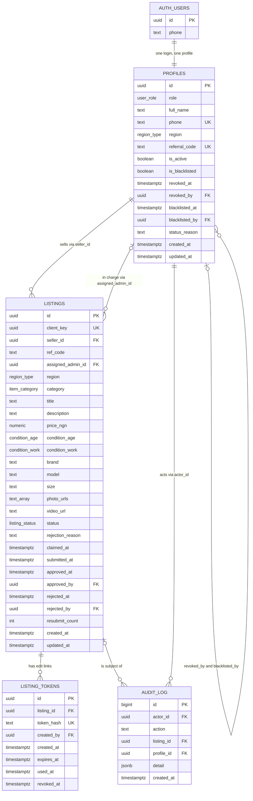

# 03 · ERD, Data Dictionary and SQL Script

Project: OBN NATION ONLINE.COM · Phase 1, the Listing Cloud · Version 1.0 · 17 Oct 2026
Database: Supabase PostgreSQL 15 · Migrations: `supabase/migrations/0001_core_schema.sql`, `0002_storage.sql` · Tests: `supabase/tests/`
Related: [01 Architecture](01_SYSTEM_ARCHITECTURE.md) · [02 PRD](02_PRD_PHASE_1.md) · [06 RBAC](06_RACI_AND_RBAC_MATRIX.md) · [07 API](07_API_CONTRACTS_AND_INTEGRATIONS.md)

Migration `0003_otp_attempts.sql` (wrong-code counter for the WhatsApp sign-in, service role only, tested by `supabase/tests/otp_attempts_test.sql`) and `0004_storage_replace_draft_files.sql` (lets a seller replace files in their own draft folder so an upload retry works) were added after this document and are not repeated in section 9. The SQL in section 9 is the exact content of the first two migration files and is the version that the automated tests run against (92 checks, all passing on PostgreSQL 16). If this document and the files ever disagree, the files win.

---

## 1. Design in one page

- **Three core tables:** `profiles` (everyone who signs in), `listings` (every item) and `listing_tokens` (edit links). A fourth table, `audit_log`, records sensitive actions.
- **Privacy by structure.** Seller name and phone live only in `profiles`. `listings` holds no personal data. Admins cannot read other people's `profiles` rows. They read `regional_listings_feed`, a view that masks the seller's name to `A***` and phone to `+234 ••• ••• ••36` unless the reader is the admin in charge or the Global Admin.
- **Rules live in the database.** Status changes, assignment, role changes, revoke and blacklist happen only inside security-definer functions that lock the row, check the caller and write the audit log in one transaction. A direct table update by an admin changes nothing.
- **Duplicates are impossible by design.** `(seller_id, client_key)` is unique, and resubmit updates the same row and burns the token in one transaction.
- **Blacklist is permanent.** A trigger blocks un-blacklisting and deleting the profile, and the phone number is unique, so the same number can never be added again.

## 2. Entity relationship diagram



Reading the diagram: one profile can sell many listings (`seller_id`), and one admin profile can be in charge of many listings (`assigned_admin_id`, optional until a listing is claimed). One listing can have many edit tokens over its life, but only one is live at a time. `client_key` is unique together with `seller_id`. `photo_urls` is a list of text paths; the diagram writes it as `text_array` because the diagram syntax has no array type.

## 3. Enumerations

| Enum | Values | Shown to users as |
|---|---|---|
| `user_role` | `seller`, `regional_admin`, `global_admin` | Seller, Regional Admin, Global Admin |
| `region_type` | `port_harcourt`, `delta`, `ekiti` | Port Harcourt, Delta, Ekiti |
| `listing_status` | `draft`, `pending_review`, `rejected`, `approved` | Draft, Under review, Needs changes, Live |
| `condition_age` | `new_sealed`, `new_open_box`, `premium_used`, `neatly_used`, `fairly_used` | New, sealed · New, open box · Premium used · Neatly used · Fairly used |
| `condition_work` | `working_perfectly`, `minor_issues`, `not_working` | Working perfectly · Minor issues · Not working |
| `item_category` | `phones`, `computers`, `tvs`, `fridges`, `generators`, `kitchen`, `furniture`, `other` | Phones, Computers, TVs, Fridges, Generators, Kitchen, Furniture, Other |

## 4. Data dictionary

### 4.1 `profiles`

One row per person who has signed in. Created by a trigger on the first verified WhatsApp OTP.

| Column | Type | Default | Null | Rule and meaning |
|---|---|---|---|---|
| `id` | uuid | none | No | Primary key. Same value as `auth.users.id`. Deleting the login deletes the profile, except blacklisted profiles (trigger blocks it) |
| `role` | user_role | `seller` | No | Changed only by `promote_to_admin` or `bootstrap_global_admin` |
| `full_name` | text | `''` | No | Up to 80 characters. Entered by the person after their first code. The only column a user can update |
| `phone` | text | none | No | Unique. Must match `^\+[1-9][0-9]{7,14}$` (E.164). Cannot change after creation. Uniqueness is what keeps a blacklisted number out |
| `region` | region_type | null | Yes | Required if and only if `role = regional_admin`. Null for sellers and Global Admins |
| `referral_code` | text | null | Yes | Unique. 8 lowercase hex characters. Made by `promote_to_admin`. Only regional admins have one |
| `is_active` | boolean | `true` | No | False when revoked or blacklisted. Every policy and function requires true |
| `is_blacklisted` | boolean | `false` | No | Permanent. A trigger refuses to set it back to false. Implies `is_active = false` |
| `revoked_at` | timestamptz | null | Yes | When the admin was revoked |
| `revoked_by` | uuid | null | Yes | Global Admin who revoked. References `profiles.id` |
| `blacklisted_at` | timestamptz | null | Yes | When blacklisted |
| `blacklisted_by` | uuid | null | Yes | Global Admin who blacklisted. References `profiles.id` |
| `status_reason` | text | null | Yes | Up to 500 characters. Reason for the latest revoke or blacklist |
| `created_at` | timestamptz | `now()` | No | |
| `updated_at` | timestamptz | `now()` | No | Set by trigger on every update |

Table constraints: `regional_admin_has_region` (role and region agree), `referral_only_regional_admin`, `blacklist_implies_inactive`.

### 4.2 `listings`

One row per item. No personal data.

| Column | Type | Default | Null | Rule and meaning |
|---|---|---|---|---|
| `id` | uuid | `gen_random_uuid()` | No | Primary key. Also the second folder level for media |
| `client_key` | uuid | none | No | Made by the browser once per listing. With `seller_id` it makes the create call idempotent |
| `seller_id` | uuid | none | No | The seller. References `profiles.id`. Cannot change |
| `ref_code` | text | null | Yes | The referral code in the seller's cookie at creation, lower-cased. Kept for audit. Cannot change |
| `assigned_admin_id` | uuid | null | Yes | The admin in charge. Set by the insert trigger from `ref_code`, or later by claim, approve, reject or reassign. Never set by the client |
| `region` | region_type | none | No | Region of the listing. Forced to the referring admin's region when a valid referral code is used |
| `category` | item_category | none | No | |
| `title` | text | none | No | 3 to 80 characters |
| `description` | text | none | No | 10 to 1000 characters |
| `price_ngn` | numeric(14,2) | none | No | Above 0 and at most 1,000,000,000 |
| `condition_age` | condition_age | none | No | Age of item (five cards) |
| `condition_work` | condition_work | none | No | Working status (three cards) |
| `brand` | text | null | Yes | Optional. 1 to 60 characters |
| `model` | text | null | Yes | Optional. 1 to 60 characters |
| `size` | text | null | Yes | Optional. 1 to 60 characters |
| `photo_urls` | text[] | `'{}'` | No | Storage paths in bucket `photos`, each starting `<seller_id>/<listing_id>/`. Up to 6. At least 1 once the status is not `draft`. The name says "urls" but the values are paths; signed URLs are made at read time |
| `video_url` | text | null | Yes | Storage path in bucket `videos`, same folder rule. Null only while the listing is a draft. The app requires a video before submit (PRD FM-4) |
| `status` | listing_status | `draft` | No | See the state machine in section 7 |
| `rejection_reason` | text | null | Yes | 5 to 500 characters. Required while `rejected`. Cleared on resubmit |
| `claimed_at` | timestamptz | null | Yes | When an admin took charge |
| `submitted_at` | timestamptz | null | Yes | When it last entered `pending_review` |
| `approved_at` | timestamptz | null | Yes | Required while `approved` |
| `approved_by` | uuid | null | Yes | Required while `approved` |
| `rejected_at` | timestamptz | null | Yes | Time of the latest rejection |
| `rejected_by` | uuid | null | Yes | Admin who rejected |
| `resubmit_count` | integer | `0` | No | Number of reject-edit-resubmit loops completed. Counts toward gate G2 |
| `created_at` | timestamptz | `now()` | No | Cannot change |
| `updated_at` | timestamptz | `now()` | No | Set by trigger |

Table constraints: `listings_idempotency` unique `(seller_id, client_key)`, `photos_max_six`, `submitted_has_photos`, `rejected_has_reason`, `approved_has_approver`.

### 4.3 `listing_tokens`

Edit links. Never readable by signed-in users.

| Column | Type | Default | Null | Rule and meaning |
|---|---|---|---|---|
| `id` | uuid | `gen_random_uuid()` | No | Primary key |
| `listing_id` | uuid | none | No | References `listings.id`. Deleted with the listing |
| `token_hash` | text | none | No | Unique. 64 lowercase hex characters: SHA-256 of the UUID in the link. The plain token is never stored |
| `created_by` | uuid | null | Yes | Admin who rejected or reissued |
| `created_at` | timestamptz | `now()` | No | |
| `expires_at` | timestamptz | `now() + 30 days` | No | |
| `used_at` | timestamptz | null | Yes | Set when the seller resubmits. This is the burn |
| `revoked_at` | timestamptz | null | Yes | Set when a newer link replaces this one |

A partial unique index allows only one live token (not used, not revoked) per listing.

### 4.4 `audit_log`

| Column | Type | Default | Null | Rule and meaning |
|---|---|---|---|---|
| `id` | bigint identity | generated | No | Primary key |
| `actor_id` | uuid | null | Yes | Who did it. Null for seller resubmit through a token |
| `action` | text | none | No | One of: `listing.claim`, `listing.approve`, `listing.reject`, `listing.reissue_link`, `listing.reassign`, `listing.resubmit`, `admin.promote`, `admin.revoke`, `admin.reinstate`, `admin.blacklist`, `admin.bootstrap_global` |
| `listing_id` | uuid | null | Yes | Set to null if the listing is deleted |
| `profile_id` | uuid | null | Yes | The person affected |
| `detail` | jsonb | `{}` | No | Reason, old and new admin, counts |
| `created_at` | timestamptz | `now()` | No | |

Gate G2 query: `select count(*) from audit_log where action = 'listing.resubmit';`

### 4.5 View `regional_listings_feed`

The only way for a regional admin to see seller details, and only in masked form unless they are in charge. The view runs with the owner's rights and does its own row filtering with `auth.uid()`.

| Column | Meaning |
|---|---|
| `id`, `region`, `category`, `title`, `description`, `price_ngn`, `condition_age`, `condition_work`, `brand`, `model`, `size`, `photo_urls`, `video_url`, `status`, `created_at`, `submitted_at`, `approved_at`, `assigned_admin_id` | Copied from `listings` |
| `admin_in_charge_name` | First word of the admin in charge's name. Null if unassigned |
| `contact_visible` | True for the admin in charge and the Global Admin |
| `seller_name` | Real name if `contact_visible`, else first letter plus `***` (for example `A***`) |
| `seller_phone` | Real phone if `contact_visible`, else `+234 ••• ••• ••` plus the last two digits (for example `+234 ••• ••• ••36`). Non-Nigerian numbers show `••• ••• ••` plus the last two digits |

Rows returned (never drafts, nothing for anonymous or blacklisted users):

| Reader | Rows |
|---|---|
| Global Admin | All non-draft listings, all regions |
| Regional admin | Listings assigned to them in any non-draft status, plus in their own region: all `approved` listings and `pending_review` listings that nobody has claimed |

## 5. Functions

### 5.1 Callable by signed-in users

| Function | Caller | What it does | Raises |
|---|---|---|---|
| `claim_listing(listing)` | Regional admin of the region, or Global Admin | Takes charge of an unclaimed pending listing. The first caller wins; the row is locked | `OB005` already claimed, `42501`, `P0002`, `55000` |
| `approve_listing(listing)` | Admin in charge, any admin of the region if unclaimed, or Global Admin | One approval makes it live. An unclaimed listing is claimed in the same step | `42501`, `P0002`, `55000` |
| `reassign_listing(listing, new_admin, reason)` | Global Admin | Moves the admin in charge. Target must be an active admin of the same region (or a Global Admin). Reason 5 to 500 characters | `42501`, `23514`, `P0002` |
| `promote_to_admin(profile, role, region)` | Global Admin | Turns a seller into a regional or global admin. Returns the referral code for regional admins | `42501`, `23514`, `OB006` already admin, `P0002` |
| `revoke_admin(profile, reason)` | Global Admin | Immediate. Releases the admin's pending listings to the open queue | `42501`, `23514`, `55006`, `P0002` |
| `reinstate_admin(profile)` | Global Admin | Reverses a revoke. Refuses blacklisted people | `42501`, `55006`, `55000`, `P0002` |

### 5.2 Server only (`service_role`)

The Next.js route verifies the caller's session first, then passes the verified user id as `p_actor`. The function checks that user again in the database.

| Function | What it does | Raises |
|---|---|---|
| `reject_listing(actor, listing, reason, token_hash)` | Rejects with a reason, stores the new token hash, revokes any older live token, claims the listing if unclaimed. Returns the token expiry | `42501`, `23514`, `55000`, `P0002` |
| `reissue_edit_link(actor, listing, token_hash)` | New link for a rejected listing. Revokes the old one | `42501`, `55000`, `P0002` |
| `blacklist_admin(actor, profile, reason)` | Permanent. Sets both flags, releases pending listings. Safe to repeat | `42501`, `23514`, `P0002` |
| `get_listing_for_edit(token_hash)` | Returns the listing as JSON for pre-fill if the token is valid. Does not use the token up | `OB001` to `OB004`, `55000` |
| `resubmit_listing(token_hash, fields)` | Locks token and listing, updates the same listing from the JSON fields, sets `pending_review`, burns the token | `OB001` to `OB004`, `55000`, `23514` |
| `purge_stale_drafts(days)` | Deletes drafts older than `days` and returns each deleted folder (`<seller>/<listing>/`) so the server can remove the files | none |

### 5.3 Owner only

`bootstrap_global_admin(phone)` makes the first Global Admin. Run once by hand in the SQL editor after the person has signed in.

### 5.4 Helpers and triggers

| Name | Purpose |
|---|---|
| `is_usable()`, `my_role()`, `my_region()`, `is_global_admin()`, `is_in_charge_of_seller(seller)` | Security-definer lookups used by policies and the view. They return nothing for revoked, blacklisted or unknown users |
| `_reviewer_ok(actor, region, assigned)` | The single review-permission rule used by all review functions |
| `_media_paths_ok(seller, listing, photos, video)` | Every media path must start with `<seller_id>/<listing_id>/` |
| `_audit(...)` | Writes `audit_log` |
| `handle_new_user` (on `auth.users` insert) | Creates the seller profile with `+` and the phone |
| `listings_before_insert` | Daily limit, referral routing, clears any client-supplied assignment, checks media paths and the seller's name |
| `listings_before_update` | Blocks immutable changes, illegal status moves and edits while under review or live; sets `submitted_at` and `updated_at` |
| `profiles_guard` | Blocks un-blacklisting, phone changes and deleting a blacklisted profile |
| `set_updated_at` | Maintains `updated_at` on profiles |

## 6. Error codes

Functions raise these so the API can map them to HTTP statuses (see [07](07_API_CONTRACTS_AND_INTEGRATIONS.md)).

| SQLSTATE | Message | Meaning |
|---|---|---|
| `42501` | `not_authorized`, `blacklisted` | Caller may not do this, or RLS refused the write |
| `P0002` | `listing_not_found`, `profile_not_found` | Missing, or not visible to this caller |
| `55000` | `invalid_state`, `invalid_transition` | Wrong status for this action |
| `55006` | `listing_locked`, `blacklist_is_permanent`, `blacklisted_profile_cannot_be_deleted`, `blacklisted` | Change is not allowed in the current state |
| `23514` | `reason_required`, `invalid_media_path`, `seller_name_required`, `invalid_target_admin`, `invalid_role`, `region_required`, `immutable_field`, `phone_required`, `invalid_initial_status`, plus any column check | Invalid input |
| `54000` | `daily_listing_limit` | More than 10 new listings in 24 hours |
| `23505` | unique violation | Duplicate `client_key`, `token_hash` or `phone` |
| `OB001` | `token_invalid` | Unknown token |
| `OB002` | `token_used` | Already burned |
| `OB003` | `token_expired` | Older than 30 days |
| `OB004` | `token_revoked` | Replaced by a newer link |
| `OB005` | `already_claimed` | Another admin got there first |
| `OB006` | `already_admin` | Profile already has an admin role |

## 7. Status state machine

| From | To | Who | How |
|---|---|---|---|
| (new) | `draft` | Seller | Insert with the seller's session |
| `draft` | `pending_review` | Seller | Update. Needs 1 to 6 photos and a name on the profile |
| `pending_review` | `approved` | Admin in charge, first admin of the region (if unclaimed), Global Admin | `approve_listing` |
| `pending_review` | `rejected` | Same people | `/api/listings/reject` → `reject_listing` |
| `rejected` | `pending_review` | Seller with a valid token | `resubmit_listing` |
| `approved` | (none) | | Content is frozen. Reassignment changes only the admin in charge |

The trigger `listings_before_update` rejects every other move. Content columns can change only in `draft` and `rejected`.

## 8. Row Level Security, privileges and storage

### 8.1 Policies

| Table | Operation | Policy | Condition |
|---|---|---|---|
| `profiles` | select | `profiles_select` | Usable user and (own row, or Global Admin, or in charge of one of this person's non-draft listings) |
| `profiles` | update | `profiles_update_own` | Own row. Column grant limits it to `full_name` |
| `profiles` | insert, delete | none | Only triggers and functions |
| `listings` | select | `listings_select_seller` | Own listings |
| `listings` | select | `listings_select_assigned` | Admin in charge, non-draft |
| `listings` | select | `listings_select_global` | Global Admin, non-draft |
| `listings` | select | `listings_select_regional` | Regional admin: own region and (approved, or pending and unclaimed) |
| `listings` | insert | `listings_insert_seller` | Own `seller_id`, usable, status `draft` or `pending_review` |
| `listings` | update | `listings_update_seller_draft` | Own draft only; new status `draft` or `pending_review` |
| `listings` | delete | `listings_delete_seller_draft` | Own draft only |
| `listing_tokens` | all | none | Only `service_role` |
| `audit_log` | select | `audit_select_global` | Global Admin |
| `audit_log` | insert | none | Only `_audit()` |
| service role | all | bypass | Supabase's `service_role` bypasses RLS and holds explicit grants |

"Usable" means the caller has a profile that is active and not blacklisted. Revoking or blacklisting flips that answer on the very next query, even if the caller still holds a valid session.

### 8.2 Privileges

All table, sequence and function privileges are revoked from `public`, `anon` and `authenticated` first, then granted back narrowly:

- `authenticated` may select `profiles`, `audit_log`, the view, and `listings`; update `profiles.full_name`; insert and update only the listed `listings` columns (never `assigned_admin_id`, `approved_*`, `rejected_*`, `resubmit_count`); delete own drafts; and execute the helpers and the six signed-in functions.
- `anon` has no access to anything.
- `service_role` has full table access and may execute the server-only functions.

### 8.3 Storage

| Bucket | Public | Size limit | Types | Path |
|---|---|---|---|---|
| `photos` | No | 1,048,576 bytes (1 MiB) | `image/webp` | `<seller_id>/<listing_id>/<n>.webp` |
| `videos` | No | 10,485,760 bytes (10 MiB) | `video/mp4` | `<seller_id>/<listing_id>/video.mp4` |

Policies on `storage.objects`: a signed-in usable user can upload only into a folder named with their own user id; can read their own folder, and can read any file that is attached to a listing they are allowed to see (the policy asks `public.listings`, so listing RLS decides). Users have no update or delete rights on files; cleanup runs on the server.

### 8.4 Indexes

| Index | On | Purpose |
|---|---|---|
| `listings_region_status_idx` | `(region, status, created_at desc)` | Regional queues and pool |
| `listings_admin_status_idx` | `(assigned_admin_id, status)` where assigned | An admin's own lists |
| `listings_seller_idx` | `(seller_id, created_at desc)` | Seller's lists and the daily limit count |
| `listings_photo_urls_gin` | GIN on `photo_urls` | Fast storage policy lookups |
| `listings_video_url_idx` | `(video_url)` where not null | Same, for videos |
| `profiles_admin_region_idx` | `(role, region)` where regional admin | Admin lookups |
| `listing_tokens_one_live_per_listing` | unique `(listing_id)` where live | One live link per listing |
| `listing_tokens_listing_idx`, `audit_log_listing_idx`, `audit_log_actor_idx` | | History lookups |

## 9. Migration scripts

### 9.1 `supabase/migrations/0001_core_schema.sql`

```sql
-- OBN NATION Phase 1: core schema.
-- Matches the client decisions of Oct 2026 (profiles, listings, listing_tokens,
-- regional_listings_feed masking view, single-approval review, 30-day edit token).
-- Target: Supabase Postgres 15. Tested on Postgres 16 with supabase/tests/.

-- ============================================================ ENUMS
create type public.user_role      as enum ('seller', 'regional_admin', 'global_admin');
create type public.region_type    as enum ('port_harcourt', 'delta', 'ekiti');
create type public.listing_status as enum ('draft', 'pending_review', 'rejected', 'approved');
create type public.condition_age  as enum ('new_sealed', 'new_open_box', 'premium_used', 'neatly_used', 'fairly_used');
create type public.condition_work as enum ('working_perfectly', 'minor_issues', 'not_working');
create type public.item_category  as enum ('phones', 'computers', 'tvs', 'fridges', 'generators', 'kitchen', 'furniture', 'other');

-- ============================================================ TABLES
create table public.profiles (
  id             uuid primary key references auth.users (id) on delete cascade,
  role           public.user_role not null default 'seller',
  full_name      text not null default '' check (char_length(full_name) <= 80),
  phone          text not null unique check (phone ~ '^\+[1-9][0-9]{7,14}$'),
  region         public.region_type,
  referral_code  text unique check (referral_code ~ '^[a-f0-9]{8}$'),
  is_active      boolean not null default true,
  is_blacklisted boolean not null default false,
  revoked_at     timestamptz,
  revoked_by     uuid references public.profiles (id),
  blacklisted_at timestamptz,
  blacklisted_by uuid references public.profiles (id),
  status_reason  text check (status_reason is null or char_length(status_reason) <= 500),
  created_at     timestamptz not null default now(),
  updated_at     timestamptz not null default now(),
  constraint regional_admin_has_region check ((role = 'regional_admin') = (region is not null)),
  constraint referral_only_regional_admin check (role = 'regional_admin' or referral_code is null),
  constraint blacklist_implies_inactive check (not is_blacklisted or not is_active)
);

create table public.listings (
  id                uuid primary key default gen_random_uuid(),
  client_key        uuid not null,
  seller_id         uuid not null references public.profiles (id) on delete restrict,
  ref_code          text,
  assigned_admin_id uuid references public.profiles (id) on delete restrict,
  region            public.region_type not null,
  category          public.item_category not null,
  title             text not null check (char_length(title) between 3 and 80),
  description       text not null check (char_length(description) between 10 and 1000),
  price_ngn         numeric(14, 2) not null check (price_ngn > 0 and price_ngn <= 1000000000),
  condition_age     public.condition_age not null,
  condition_work    public.condition_work not null,
  brand             text check (brand is null or char_length(brand) between 1 and 60),
  model             text check (model is null or char_length(model) between 1 and 60),
  size              text check (size is null or char_length(size) between 1 and 60),
  photo_urls        text[] not null default '{}',   -- storage object paths in bucket "photos"
  video_url         text,                            -- storage object path in bucket "videos"; optional
  status            public.listing_status not null default 'draft',
  rejection_reason  text check (rejection_reason is null or char_length(rejection_reason) between 5 and 500),
  claimed_at        timestamptz,
  submitted_at      timestamptz,
  approved_at       timestamptz,
  approved_by       uuid references public.profiles (id),
  rejected_at       timestamptz,
  rejected_by       uuid references public.profiles (id),
  resubmit_count    integer not null default 0 check (resubmit_count >= 0),
  created_at        timestamptz not null default now(),
  updated_at        timestamptz not null default now(),
  constraint listings_idempotency unique (seller_id, client_key),
  constraint photos_max_six check (cardinality(photo_urls) <= 6),
  constraint submitted_has_photos check (status = 'draft' or cardinality(photo_urls) between 1 and 6),
  constraint rejected_has_reason check (status <> 'rejected' or rejection_reason is not null),
  constraint approved_has_approver check (status <> 'approved' or (approved_by is not null and approved_at is not null))
);

create table public.listing_tokens (
  id         uuid primary key default gen_random_uuid(),
  listing_id uuid not null references public.listings (id) on delete cascade,
  token_hash text not null unique check (token_hash ~ '^[0-9a-f]{64}$'),   -- SHA-256 of the UUID in the link
  created_by uuid references public.profiles (id),
  created_at timestamptz not null default now(),
  expires_at timestamptz not null default now() + interval '30 days',
  used_at    timestamptz,
  revoked_at timestamptz
);
create unique index listing_tokens_one_live_per_listing
  on public.listing_tokens (listing_id) where used_at is null and revoked_at is null;

create table public.audit_log (
  id         bigint generated always as identity primary key,
  actor_id   uuid references public.profiles (id),
  action     text not null,
  listing_id uuid references public.listings (id) on delete set null,
  profile_id uuid references public.profiles (id) on delete set null,
  detail     jsonb not null default '{}'::jsonb,
  created_at timestamptz not null default now()
);

-- ============================================================ INDEXES
create index listings_region_status_idx   on public.listings (region, status, created_at desc);
create index listings_admin_status_idx    on public.listings (assigned_admin_id, status) where assigned_admin_id is not null;
create index listings_seller_idx          on public.listings (seller_id, created_at desc);
create index listings_photo_urls_gin      on public.listings using gin (photo_urls);
create index listings_video_url_idx       on public.listings (video_url) where video_url is not null;
create index profiles_admin_region_idx    on public.profiles (role, region) where role = 'regional_admin';
create index listing_tokens_listing_idx   on public.listing_tokens (listing_id);
create index audit_log_listing_idx        on public.audit_log (listing_id, created_at desc);
create index audit_log_actor_idx          on public.audit_log (actor_id, created_at desc);

-- ============================================================ HELPER FUNCTIONS
-- All helpers are SECURITY DEFINER so policies on profiles never recurse into themselves.
create function public.is_usable() returns boolean
language sql stable security definer set search_path = '' as $$
  select exists (select 1 from public.profiles p
                 where p.id = auth.uid() and p.is_active and not p.is_blacklisted)
$$;

create function public.my_role() returns public.user_role
language sql stable security definer set search_path = '' as $$
  select p.role from public.profiles p
  where p.id = auth.uid() and p.is_active and not p.is_blacklisted
$$;

create function public.my_region() returns public.region_type
language sql stable security definer set search_path = '' as $$
  select p.region from public.profiles p
  where p.id = auth.uid() and p.is_active and not p.is_blacklisted
$$;

create function public.is_global_admin() returns boolean
language sql stable security definer set search_path = '' as $$
  select coalesce((select p.role = 'global_admin' from public.profiles p
                   where p.id = auth.uid() and p.is_active and not p.is_blacklisted), false)
$$;

create function public.is_in_charge_of_seller(p_seller uuid) returns boolean
language sql stable security definer set search_path = '' as $$
  select exists (select 1 from public.listings l
                 where l.seller_id = p_seller and l.assigned_admin_id = auth.uid()
                   and l.status <> 'draft')
     and public.my_role() in ('regional_admin', 'global_admin')
$$;

create function public._audit(p_actor uuid, p_action text, p_listing uuid, p_profile uuid, p_detail jsonb default '{}'::jsonb)
returns void language sql security definer set search_path = '' as $$
  insert into public.audit_log (actor_id, action, listing_id, profile_id, detail)
  values (p_actor, p_action, p_listing, p_profile, coalesce(p_detail, '{}'::jsonb))
$$;

-- May this person review this listing? Global admins always. Regional admins only in their
-- own region, and only if the listing is unassigned or assigned to them.
create function public._reviewer_ok(p_actor uuid, p_region public.region_type, p_assigned uuid)
returns boolean language sql stable security definer set search_path = '' as $$
  select exists (
    select 1 from public.profiles p
    where p.id = p_actor and p.is_active and not p.is_blacklisted
      and (p.role = 'global_admin'
           or (p.role = 'regional_admin' and p.region = p_region
               and (p_assigned is null or p_assigned = p.id))))
$$;

create function public.set_updated_at() returns trigger language plpgsql as $$
begin new.updated_at := now(); return new; end $$;

-- ============================================================ TRIGGERS
-- New auth user (first verified WhatsApp OTP) -> seller profile. Phone is unique, so a
-- blacklisted phone can never get a second account.
create function public.handle_new_user() returns trigger
language plpgsql security definer set search_path = '' as $$
begin
  if new.phone is null or btrim(new.phone) = '' then
    raise exception 'phone_required' using errcode = '23514';
  end if;
  insert into public.profiles (id, phone)
  values (new.id, '+' || regexp_replace(btrim(new.phone), '^\+', ''));
  return new;
end $$;
create trigger on_auth_user_created after insert on auth.users
  for each row execute function public.handle_new_user();

create function public.profiles_guard() returns trigger language plpgsql as $$
begin
  if tg_op = 'DELETE' then
    if old.is_blacklisted then
      raise exception 'blacklisted_profile_cannot_be_deleted' using errcode = '55006';
    end if;
    return old;
  end if;
  if old.is_blacklisted and not new.is_blacklisted then
    raise exception 'blacklist_is_permanent' using errcode = '55006';
  end if;
  if new.phone <> old.phone or new.id <> old.id then
    raise exception 'immutable_field' using errcode = '23514';
  end if;
  return new;
end $$;
create trigger profiles_guard_upd before update on public.profiles
  for each row execute function public.profiles_guard();
create trigger profiles_guard_del before delete on public.profiles
  for each row execute function public.profiles_guard();
create trigger profiles_touch before update on public.profiles
  for each row execute function public.set_updated_at();

-- Media paths must live inside <seller_id>/<listing_id>/ so nobody can point at another seller's files.
create function public._media_paths_ok(p_seller uuid, p_listing uuid, p_photos text[], p_video text)
returns boolean language sql immutable as $$
  select not exists (select 1 from unnest(p_photos) u
                     where u not like (p_seller::text || '/' || p_listing::text || '/%'))
     and (p_video is null or p_video like (p_seller::text || '/' || p_listing::text || '/%'))
$$;

create function public.listings_before_insert() returns trigger
language plpgsql security definer set search_path = '' as $$
declare v_admin public.profiles; v_count integer; v_name text;
begin
  -- Daily limit (assumed default: 10 new listings per seller per 24h). A retry of the same client_key is not counted.
  if not exists (select 1 from public.listings where seller_id = new.seller_id and client_key = new.client_key) then
    select count(*) into v_count from public.listings
    where seller_id = new.seller_id and created_at > now() - interval '24 hours';
    if v_count >= 10 then
      raise exception 'daily_listing_limit' using errcode = '54000';
    end if;
  end if;

  -- Routing is decided here, never by the client.
  new.assigned_admin_id := null; new.claimed_at := null;
  new.approved_at := null; new.approved_by := null;
  new.rejected_at := null; new.rejected_by := null;
  new.rejection_reason := null; new.resubmit_count := 0; new.submitted_at := null;

  if new.ref_code is not null then
    new.ref_code := lower(btrim(new.ref_code));
    select * into v_admin from public.profiles
    where referral_code = new.ref_code and role = 'regional_admin' and is_active and not is_blacklisted;
    if found then
      new.assigned_admin_id := v_admin.id;
      new.region := v_admin.region;          -- a referral listing always belongs to the admin's region
      new.claimed_at := now();
    end if;
  end if;

  if not public._media_paths_ok(new.seller_id, new.id, new.photo_urls, new.video_url) then
    raise exception 'invalid_media_path' using errcode = '23514';
  end if;

  if new.status = 'pending_review' then
    select full_name into v_name from public.profiles where id = new.seller_id;
    if char_length(btrim(coalesce(v_name, ''))) < 2 then
      raise exception 'seller_name_required' using errcode = '23514';
    end if;
    new.submitted_at := now();
  elsif new.status <> 'draft' then
    raise exception 'invalid_initial_status' using errcode = '23514';
  end if;
  return new;
end $$;
create trigger listings_before_insert_trg before insert on public.listings
  for each row execute function public.listings_before_insert();

create function public.listings_before_update() returns trigger
language plpgsql security definer set search_path = '' as $$
declare v_name text;
begin
  if new.id <> old.id or new.seller_id <> old.seller_id or new.client_key <> old.client_key
     or new.ref_code is distinct from old.ref_code or new.created_at <> old.created_at then
    raise exception 'immutable_field' using errcode = '23514';
  end if;

  if new.status <> old.status and (old.status, new.status) not in (
       ('draft', 'pending_review'), ('pending_review', 'approved'),
       ('pending_review', 'rejected'), ('rejected', 'pending_review')) then
    raise exception 'invalid_transition' using errcode = '55000';
  end if;

  -- Content can change only while the listing is a draft or has been rejected.
  if old.status in ('pending_review', 'approved') and
     (new.category, new.title, new.description, new.price_ngn, new.condition_age, new.condition_work,
      new.brand, new.model, new.size, new.photo_urls, new.video_url, new.region)
     is distinct from
     (old.category, old.title, old.description, old.price_ngn, old.condition_age, old.condition_work,
      old.brand, old.model, old.size, old.photo_urls, old.video_url, old.region) then
    raise exception 'listing_locked' using errcode = '55006';
  end if;

  if not public._media_paths_ok(new.seller_id, new.id, new.photo_urls, new.video_url) then
    raise exception 'invalid_media_path' using errcode = '23514';
  end if;

  if old.status = 'draft' and new.status = 'pending_review' then
    select full_name into v_name from public.profiles where id = new.seller_id;
    if char_length(btrim(coalesce(v_name, ''))) < 2 then
      raise exception 'seller_name_required' using errcode = '23514';
    end if;
    new.submitted_at := now();
  end if;
  new.updated_at := now();
  return new;
end $$;
create trigger listings_before_update_trg before update on public.listings
  for each row execute function public.listings_before_update();

-- ============================================================ REVIEW FUNCTIONS (signed-in admins)
create function public.claim_listing(p_listing uuid) returns void
language plpgsql security definer set search_path = '' as $$
declare l public.listings; v_actor uuid := auth.uid();
begin
  select * into l from public.listings where id = p_listing for update;
  if not found or l.status = 'draft' then raise exception 'listing_not_found' using errcode = 'P0002'; end if;
  if l.assigned_admin_id is not null then raise exception 'already_claimed' using errcode = 'OB005'; end if;
  if not public._reviewer_ok(v_actor, l.region, null) then raise exception 'not_authorized' using errcode = '42501'; end if;
  if l.status <> 'pending_review' then raise exception 'invalid_state' using errcode = '55000'; end if;
  update public.listings set assigned_admin_id = v_actor, claimed_at = now() where id = l.id;
  perform public._audit(v_actor, 'listing.claim', l.id, null, '{}');
end $$;

-- One approval is enough. Whoever approves an unassigned listing becomes the admin in charge.
create function public.approve_listing(p_listing uuid) returns void
language plpgsql security definer set search_path = '' as $$
declare l public.listings; v_actor uuid := auth.uid();
begin
  select * into l from public.listings where id = p_listing for update;
  if not found or l.status = 'draft' then raise exception 'listing_not_found' using errcode = 'P0002'; end if;
  if not public._reviewer_ok(v_actor, l.region, l.assigned_admin_id) then raise exception 'not_authorized' using errcode = '42501'; end if;
  if l.status <> 'pending_review' then raise exception 'invalid_state' using errcode = '55000'; end if;
  update public.listings
     set status = 'approved', approved_by = v_actor, approved_at = now(),
         assigned_admin_id = coalesce(assigned_admin_id, v_actor),
         claimed_at = coalesce(claimed_at, now())
   where id = l.id;
  perform public._audit(v_actor, 'listing.approve', l.id, null,
                        jsonb_build_object('claimed_on_approve', l.assigned_admin_id is null));
end $$;

create function public.reassign_listing(p_listing uuid, p_new_admin uuid, p_reason text) returns void
language plpgsql security definer set search_path = '' as $$
declare l public.listings; v_actor uuid := auth.uid(); t public.profiles;
begin
  if not public.is_global_admin() then raise exception 'not_authorized' using errcode = '42501'; end if;
  if p_reason is null or char_length(btrim(p_reason)) < 5 or char_length(p_reason) > 500 then
    raise exception 'reason_required' using errcode = '23514';
  end if;
  select * into l from public.listings where id = p_listing for update;
  if not found or l.status = 'draft' then raise exception 'listing_not_found' using errcode = 'P0002'; end if;
  select * into t from public.profiles where id = p_new_admin;
  if not found or not t.is_active or t.is_blacklisted
     or t.role not in ('regional_admin', 'global_admin')
     or (t.role = 'regional_admin' and t.region <> l.region) then
    raise exception 'invalid_target_admin' using errcode = '23514';
  end if;
  update public.listings set assigned_admin_id = p_new_admin, claimed_at = coalesce(claimed_at, now()) where id = l.id;
  perform public._audit(v_actor, 'listing.reassign', l.id, p_new_admin,
        jsonb_build_object('from', l.assigned_admin_id, 'to', p_new_admin, 'reason', btrim(p_reason)));
end $$;

-- ============================================================ GLOBAL ADMIN FUNCTIONS (signed-in)
create function public.promote_to_admin(p_profile uuid, p_role public.user_role, p_region public.region_type default null)
returns text language plpgsql security definer set search_path = '' as $$
declare v_actor uuid := auth.uid(); t public.profiles; v_code text;
begin
  if not public.is_global_admin() then raise exception 'not_authorized' using errcode = '42501'; end if;
  if p_role not in ('regional_admin', 'global_admin') then raise exception 'invalid_role' using errcode = '23514'; end if;
  if p_role = 'regional_admin' and p_region is null then raise exception 'region_required' using errcode = '23514'; end if;
  select * into t from public.profiles where id = p_profile for update;
  if not found then raise exception 'profile_not_found' using errcode = 'P0002'; end if;
  if t.is_blacklisted then raise exception 'blacklisted' using errcode = '42501'; end if;
  if t.role <> 'seller' then raise exception 'already_admin' using errcode = 'OB006'; end if;
  if p_role = 'regional_admin' then
    v_code := substr(replace(gen_random_uuid()::text, '-', ''), 1, 8);
    update public.profiles set role = 'regional_admin', region = p_region, referral_code = v_code, is_active = true
     where id = t.id;
  else
    update public.profiles set role = 'global_admin', region = null, referral_code = null, is_active = true
     where id = t.id;
  end if;
  perform public._audit(v_actor, 'admin.promote', null, t.id,
        jsonb_build_object('role', p_role, 'region', p_region));
  return v_code;
end $$;

create function public.revoke_admin(p_profile uuid, p_reason text) returns void
language plpgsql security definer set search_path = '' as $$
declare v_actor uuid := auth.uid(); t public.profiles; v_released integer;
begin
  if not public.is_global_admin() then raise exception 'not_authorized' using errcode = '42501'; end if;
  if p_reason is null or char_length(btrim(p_reason)) < 5 or char_length(p_reason) > 500 then
    raise exception 'reason_required' using errcode = '23514';
  end if;
  select * into t from public.profiles where id = p_profile for update;
  if not found or t.role <> 'regional_admin' then raise exception 'profile_not_found' using errcode = 'P0002'; end if;
  if t.is_blacklisted then raise exception 'blacklisted' using errcode = '55006'; end if;
  update public.profiles
     set is_active = false, revoked_at = now(), revoked_by = v_actor, status_reason = btrim(p_reason)
   where id = t.id;
  update public.listings set assigned_admin_id = null, claimed_at = null
   where assigned_admin_id = t.id and status = 'pending_review';
  get diagnostics v_released = row_count;
  perform public._audit(v_actor, 'admin.revoke', null, t.id,
        jsonb_build_object('reason', btrim(p_reason), 'pending_released', v_released));
end $$;

create function public.reinstate_admin(p_profile uuid) returns void
language plpgsql security definer set search_path = '' as $$
declare v_actor uuid := auth.uid(); t public.profiles;
begin
  if not public.is_global_admin() then raise exception 'not_authorized' using errcode = '42501'; end if;
  select * into t from public.profiles where id = p_profile for update;
  if not found or t.role <> 'regional_admin' then raise exception 'profile_not_found' using errcode = 'P0002'; end if;
  if t.is_blacklisted then raise exception 'blacklisted' using errcode = '55006'; end if;
  if t.is_active then raise exception 'invalid_state' using errcode = '55000'; end if;
  update public.profiles set is_active = true, revoked_at = null, revoked_by = null, status_reason = null where id = t.id;
  perform public._audit(v_actor, 'admin.reinstate', null, t.id, '{}');
end $$;

-- ============================================================ SERVER-ONLY FUNCTIONS (service_role)
-- These are called from Next.js route handlers after the route has verified the caller's JWT.
-- The route passes the verified user id as p_actor; the function re-checks that user in the database.
create function public.reject_listing(p_actor uuid, p_listing uuid, p_reason text, p_token_hash text)
returns timestamptz language plpgsql security definer set search_path = '' as $$
declare l public.listings; v_expires timestamptz;
begin
  if p_reason is null or char_length(btrim(p_reason)) < 5 or char_length(p_reason) > 500 then
    raise exception 'reason_required' using errcode = '23514';
  end if;
  select * into l from public.listings where id = p_listing for update;
  if not found or l.status = 'draft' then raise exception 'listing_not_found' using errcode = 'P0002'; end if;
  if not public._reviewer_ok(p_actor, l.region, l.assigned_admin_id) then raise exception 'not_authorized' using errcode = '42501'; end if;
  if l.status <> 'pending_review' then raise exception 'invalid_state' using errcode = '55000'; end if;
  update public.listing_tokens set revoked_at = now()
   where listing_id = l.id and used_at is null and revoked_at is null;
  insert into public.listing_tokens (listing_id, token_hash, created_by)
  values (l.id, p_token_hash, p_actor) returning expires_at into v_expires;
  update public.listings
     set status = 'rejected', rejection_reason = btrim(p_reason), rejected_by = p_actor, rejected_at = now(),
         assigned_admin_id = coalesce(assigned_admin_id, p_actor), claimed_at = coalesce(claimed_at, now())
   where id = l.id;
  perform public._audit(p_actor, 'listing.reject', l.id, null, jsonb_build_object('reason', btrim(p_reason)));
  return v_expires;
end $$;

create function public.reissue_edit_link(p_actor uuid, p_listing uuid, p_token_hash text)
returns timestamptz language plpgsql security definer set search_path = '' as $$
declare l public.listings; v_expires timestamptz;
begin
  select * into l from public.listings where id = p_listing for update;
  if not found or l.status = 'draft' then raise exception 'listing_not_found' using errcode = 'P0002'; end if;
  if not public._reviewer_ok(p_actor, l.region, l.assigned_admin_id) then raise exception 'not_authorized' using errcode = '42501'; end if;
  if l.status <> 'rejected' then raise exception 'invalid_state' using errcode = '55000'; end if;
  update public.listing_tokens set revoked_at = now()
   where listing_id = l.id and used_at is null and revoked_at is null;
  insert into public.listing_tokens (listing_id, token_hash, created_by)
  values (l.id, p_token_hash, p_actor) returning expires_at into v_expires;
  perform public._audit(p_actor, 'listing.reissue_link', l.id, null, '{}');
  return v_expires;
end $$;

create function public.blacklist_admin(p_actor uuid, p_profile uuid, p_reason text) returns void
language plpgsql security definer set search_path = '' as $$
declare a public.profiles; t public.profiles; v_released integer;
begin
  select * into a from public.profiles where id = p_actor;
  if not found or a.role <> 'global_admin' or not a.is_active or a.is_blacklisted then
    raise exception 'not_authorized' using errcode = '42501';
  end if;
  if p_reason is null or char_length(btrim(p_reason)) < 5 or char_length(p_reason) > 500 then
    raise exception 'reason_required' using errcode = '23514';
  end if;
  select * into t from public.profiles where id = p_profile for update;
  if not found or t.role <> 'regional_admin' then raise exception 'profile_not_found' using errcode = 'P0002'; end if;
  if t.is_blacklisted then return; end if;   -- already done; safe to repeat
  update public.profiles
     set is_blacklisted = true, is_active = false, blacklisted_at = now(), blacklisted_by = p_actor,
         status_reason = btrim(p_reason)
   where id = t.id;
  update public.listings set assigned_admin_id = null, claimed_at = null
   where assigned_admin_id = t.id and status = 'pending_review';
  get diagnostics v_released = row_count;
  perform public._audit(p_actor, 'admin.blacklist', null, t.id,
        jsonb_build_object('reason', btrim(p_reason), 'pending_released', v_released));
end $$;

create function public.get_listing_for_edit(p_token_hash text) returns jsonb
language plpgsql security definer set search_path = '' as $$
declare tok public.listing_tokens; l public.listings;
begin
  select * into tok from public.listing_tokens where token_hash = p_token_hash;
  if not found then raise exception 'token_invalid' using errcode = 'OB001'; end if;
  if tok.revoked_at is not null then raise exception 'token_revoked' using errcode = 'OB004'; end if;
  if tok.used_at is not null then raise exception 'token_used' using errcode = 'OB002'; end if;
  if tok.expires_at <= now() then raise exception 'token_expired' using errcode = 'OB003'; end if;
  select * into l from public.listings where id = tok.listing_id;
  if l.status <> 'rejected' then raise exception 'invalid_state' using errcode = '55000'; end if;
  return jsonb_build_object(
    'listing_id', l.id, 'seller_id', l.seller_id, 'region', l.region, 'category', l.category,
    'title', l.title, 'description', l.description, 'price_ngn', l.price_ngn,
    'condition_age', l.condition_age, 'condition_work', l.condition_work,
    'brand', l.brand, 'model', l.model, 'size', l.size,
    'photo_urls', to_jsonb(l.photo_urls), 'video_url', l.video_url,
    'rejection_reason', l.rejection_reason, 'expires_at', tok.expires_at);
end $$;

-- Resubmit updates the SAME listing and burns the token in one transaction. The row locks make a
-- double tap safe: the second call waits, finds the token used, and fails with OB002.
create function public.resubmit_listing(p_token_hash text, p_fields jsonb) returns uuid
language plpgsql security definer set search_path = '' as $$
declare tok public.listing_tokens; l public.listings;
begin
  select * into tok from public.listing_tokens where token_hash = p_token_hash for update;
  if not found then raise exception 'token_invalid' using errcode = 'OB001'; end if;
  if tok.revoked_at is not null then raise exception 'token_revoked' using errcode = 'OB004'; end if;
  if tok.used_at is not null then raise exception 'token_used' using errcode = 'OB002'; end if;
  if tok.expires_at <= now() then raise exception 'token_expired' using errcode = 'OB003'; end if;
  select * into l from public.listings where id = tok.listing_id for update;
  if l.status <> 'rejected' then raise exception 'invalid_state' using errcode = '55000'; end if;

  update public.listings set
    category       = case when p_fields ? 'category'       then (p_fields->>'category')::public.item_category       else category end,
    title          = case when p_fields ? 'title'          then p_fields->>'title'                                  else title end,
    description    = case when p_fields ? 'description'    then p_fields->>'description'                            else description end,
    price_ngn      = case when p_fields ? 'price_ngn'      then (p_fields->>'price_ngn')::numeric                   else price_ngn end,
    condition_age  = case when p_fields ? 'condition_age'  then (p_fields->>'condition_age')::public.condition_age  else condition_age end,
    condition_work = case when p_fields ? 'condition_work' then (p_fields->>'condition_work')::public.condition_work else condition_work end,
    brand          = case when p_fields ? 'brand'          then nullif(btrim(p_fields->>'brand'), '')               else brand end,
    model          = case when p_fields ? 'model'          then nullif(btrim(p_fields->>'model'), '')               else model end,
    size           = case when p_fields ? 'size'           then nullif(btrim(p_fields->>'size'), '')                else size end,
    photo_urls     = case when p_fields ? 'photo_urls'     then array(select jsonb_array_elements_text(p_fields->'photo_urls')) else photo_urls end,
    video_url      = case when p_fields ? 'video_url'      then nullif(p_fields->>'video_url', '')                  else video_url end,
    status = 'pending_review', rejection_reason = null,
    resubmit_count = resubmit_count + 1, submitted_at = now()
  where id = l.id;

  update public.listing_tokens set used_at = now() where id = tok.id;
  perform public._audit(null, 'listing.resubmit', l.id, l.seller_id,
        jsonb_build_object('resubmit_count', l.resubmit_count + 1));
  return l.id;
end $$;

-- Deletes drafts older than p_days and returns the storage folder of each so the server can remove the files.
create function public.purge_stale_drafts(p_days integer default 7) returns setof text
language sql security definer set search_path = '' as $$
  delete from public.listings
   where status = 'draft' and created_at < now() - make_interval(days => p_days)
  returning seller_id::text || '/' || id::text || '/'
$$;

-- Run once, by hand, in the Supabase SQL editor after the owner signs in with WhatsApp OTP.
create function public.bootstrap_global_admin(p_phone text) returns uuid
language plpgsql security definer set search_path = '' as $$
declare v_id uuid;
begin
  update public.profiles set role = 'global_admin', region = null, referral_code = null, is_active = true
   where phone = p_phone and not is_blacklisted returning id into v_id;
  if v_id is null then raise exception 'profile_not_found_sign_in_once_first' using errcode = 'P0002'; end if;
  perform public._audit(v_id, 'admin.bootstrap_global', null, v_id, '{}');
  return v_id;
end $$;

-- ============================================================ MASKING VIEW
-- The only way a regional admin can read seller name and phone of a listing they are not in charge of,
-- and they only ever get the masked form. It runs with the owner's rights and filters rows itself.
create view public.regional_listings_feed with (security_invoker = false) as
select
  l.id, l.region, l.category, l.title, l.description, l.price_ngn,
  l.condition_age, l.condition_work, l.brand, l.model, l.size,
  l.photo_urls, l.video_url, l.status, l.created_at, l.submitted_at, l.approved_at,
  l.assigned_admin_id,
  split_part(btrim(a.full_name), ' ', 1)                   as admin_in_charge_name,
  v.unmasked                                               as contact_visible,
  case when v.unmasked then sp.full_name
       else left(btrim(sp.full_name), 1) || '***' end      as seller_name,
  case when v.unmasked then sp.phone
       when sp.phone like '+234%' then '+234 ••• ••• ••' || right(sp.phone, 2)
       else '••• ••• ••' || right(sp.phone, 2) end         as seller_phone
from public.listings l
join public.profiles sp on sp.id = l.seller_id
left join public.profiles a on a.id = l.assigned_admin_id
cross join lateral (
  select coalesce(l.assigned_admin_id = (select auth.uid()), false) or (select public.is_global_admin()) as unmasked
) v
where (select public.is_usable())
  and l.status <> 'draft'
  and ( (select public.is_global_admin())
        or ( (select public.my_role()) = 'regional_admin'
             and ( l.assigned_admin_id = (select auth.uid())
                   or ( l.region = (select public.my_region())
                        and ( l.status = 'approved'
                              or (l.status = 'pending_review' and l.assigned_admin_id is null) ) ) ) ) );

-- ============================================================ ROW LEVEL SECURITY
alter table public.profiles       enable row level security;
alter table public.listings       enable row level security;
alter table public.listing_tokens enable row level security;
alter table public.audit_log      enable row level security;

-- profiles: own row, global admin sees all, an admin sees sellers of listings they are in charge of.
create policy profiles_select on public.profiles for select to authenticated
  using (public.is_usable() and (id = auth.uid() or public.is_global_admin() or public.is_in_charge_of_seller(id)));
create policy profiles_update_own on public.profiles for update to authenticated
  using (id = auth.uid() and public.is_usable()) with check (id = auth.uid());   -- column grant limits this to full_name

-- listings: no personal data lives here, so admins can read listing content directly.
create policy listings_select_seller on public.listings for select to authenticated
  using (seller_id = auth.uid() and public.is_usable());
create policy listings_select_assigned on public.listings for select to authenticated
  using (assigned_admin_id = auth.uid() and status <> 'draft' and public.my_role() in ('regional_admin', 'global_admin'));
create policy listings_select_global on public.listings for select to authenticated
  using (public.is_global_admin() and status <> 'draft');
create policy listings_select_regional on public.listings for select to authenticated
  using (public.my_role() = 'regional_admin' and region = public.my_region()
         and (status = 'approved' or (status = 'pending_review' and assigned_admin_id is null)));
create policy listings_insert_seller on public.listings for insert to authenticated
  with check (seller_id = auth.uid() and public.is_usable() and status in ('draft', 'pending_review'));
create policy listings_update_seller_draft on public.listings for update to authenticated
  using (seller_id = auth.uid() and status = 'draft' and public.is_usable())
  with check (seller_id = auth.uid() and status in ('draft', 'pending_review'));
create policy listings_delete_seller_draft on public.listings for delete to authenticated
  using (seller_id = auth.uid() and status = 'draft' and public.is_usable());

-- audit_log: global admin reads; writes only through the functions above.
create policy audit_select_global on public.audit_log for select to authenticated
  using (public.is_global_admin());

-- listing_tokens: no policy for signed-in users at all. Only service_role (RLS bypass) touches it.

-- ============================================================ PRIVILEGES
revoke all on all tables    in schema public from public, anon, authenticated;
revoke all on all sequences in schema public from public, anon, authenticated;
revoke execute on all functions in schema public from public, anon, authenticated;

grant select on public.profiles to authenticated;
grant update (full_name) on public.profiles to authenticated;
grant select, delete on public.listings to authenticated;
grant insert (client_key, seller_id, ref_code, region, category, title, description, price_ngn,
              condition_age, condition_work, brand, model, size, photo_urls, video_url, status)
  on public.listings to authenticated;
grant update (category, title, description, price_ngn, condition_age, condition_work,
              brand, model, size, photo_urls, video_url, status)
  on public.listings to authenticated;
grant select on public.audit_log to authenticated;
grant select on public.regional_listings_feed to authenticated;

grant execute on function public.is_usable(), public.my_role(), public.my_region(),
  public.is_global_admin(), public.is_in_charge_of_seller(uuid) to authenticated;
grant execute on function public.claim_listing(uuid), public.approve_listing(uuid),
  public.reassign_listing(uuid, uuid, text),
  public.promote_to_admin(uuid, public.user_role, public.region_type),
  public.revoke_admin(uuid, text), public.reinstate_admin(uuid) to authenticated;

grant all on all tables    in schema public to service_role;
grant all on all sequences in schema public to service_role;
grant execute on function public.reject_listing(uuid, uuid, text, text),
  public.reissue_edit_link(uuid, uuid, text), public.blacklist_admin(uuid, uuid, text),
  public.get_listing_for_edit(text), public.resubmit_listing(text, jsonb),
  public.purge_stale_drafts(integer) to service_role;
```

### 9.2 `supabase/migrations/0002_storage.sql`

```sql
-- Private buckets for listing media. Guarded so it is skipped where Supabase Storage is absent.
-- Object path layout (both buckets): <seller_id>/<listing_id>/<file>
--   photos: WebP, under 1MB each     videos: MP4, under 10MB, one per listing (required before submit)
do $$
begin
  if to_regclass('storage.buckets') is not null then
    insert into storage.buckets (id, name, public, file_size_limit, allowed_mime_types) values
      ('photos', 'photos', false, 1048576,  array['image/webp']),
      ('videos', 'videos', false, 10485760, array['video/mp4'])
    on conflict (id) do nothing;

    -- Sellers upload only into their own folder.
    create policy media_insert_own on storage.objects for insert to authenticated
      with check (bucket_id in ('photos', 'videos')
                  and (storage.foldername(name))[1] = auth.uid()::text
                  and public.is_usable());

    -- Read: your own folder, or any file attached to a listing you are allowed to see.
    -- The subquery on public.listings runs with the caller's rights, so listing RLS decides.
    create policy media_select on storage.objects for select to authenticated
      using (bucket_id in ('photos', 'videos') and public.is_usable() and (
        (storage.foldername(name))[1] = auth.uid()::text
        or exists (select 1 from public.listings l
                   where (bucket_id = 'photos' and storage.objects.name = any (l.photo_urls))
                      or (bucket_id = 'videos' and storage.objects.name = l.video_url))));
    -- No update or delete policy for users. Cleanup runs on the server with service_role.
  end if;
end $$;
```

## 10. Running the tests

```bash
createdb obn_test
psql obn_test -f supabase/tests/stub_auth.sql                      # stand-in for Supabase auth and storage
psql obn_test -f supabase/migrations/0001_core_schema.sql
psql obn_test -f supabase/migrations/0002_storage.sql
psql obn_test -f supabase/migrations/0003_otp_attempts.sql
psql obn_test -f supabase/migrations/0004_storage_replace_draft_files.sql
psql obn_test -f supabase/migrations/0005_region_for_ref.sql
psql obn_test -f supabase/tests/rls_test.sql                       # prints "ALL TESTS PASSED"
psql obn_test -f supabase/tests/otp_attempts_test.sql              # prints "OTP TESTS PASSED"
psql obn_test -f supabase/tests/ref_region_test.sql                # prints "REF REGION TESTS PASSED"
```

The suite has 92 checks. They cover masking, claim races, single approval, referral routing, the token life cycle (valid, burned, expired, revoked, replay), duplicate prevention, revoke and blacklist effects, privilege boundaries, the daily limit, draft purge and storage access. Section 5 of [08](08_QA_TEST_CASES_AND_ACCEPTANCE.md) lists them and section 2 maps them to the QA scenarios.

Not covered by SQL tests: two requests arriving at exactly the same instant (the row locks handle it; test with real concurrency in staging), Supabase Auth's real behaviour, and Storage's real API.

## 11. First Global Admin

1. Aghughu Omo-Odion Destiny opens `/list` and signs in with WhatsApp OTP using 08053466836. This creates his profile as a seller.
2. In the Supabase SQL editor run: `select public.bootstrap_global_admin('+2348053466836');`
3. He now opens `/admin/global` and adds regional admins.
