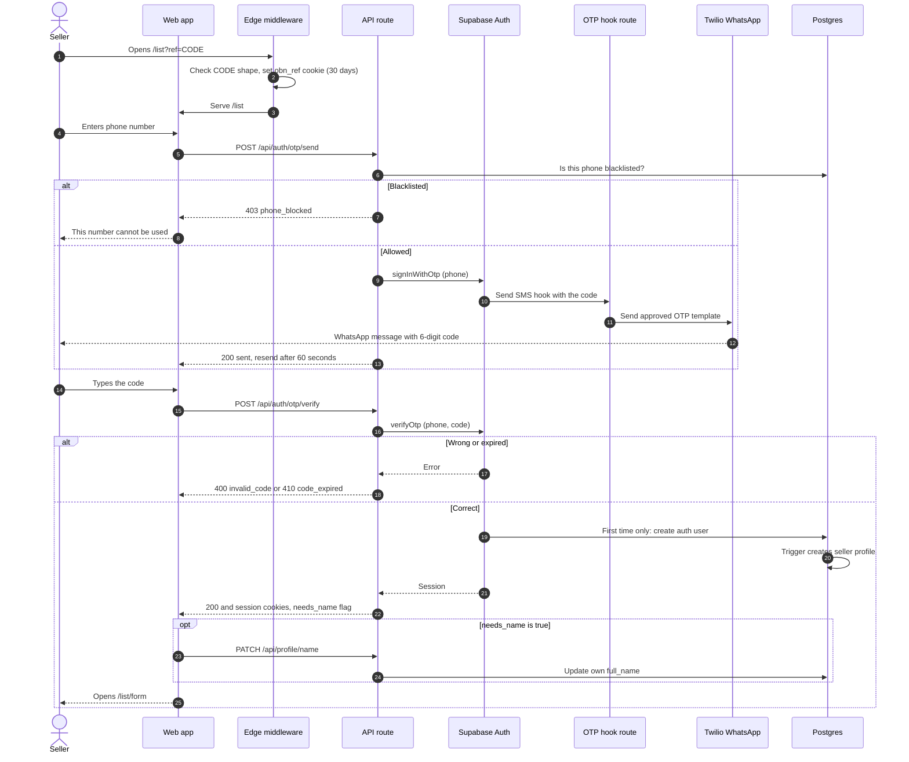
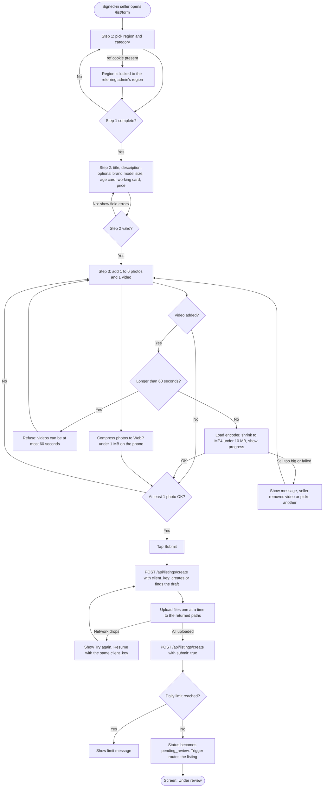
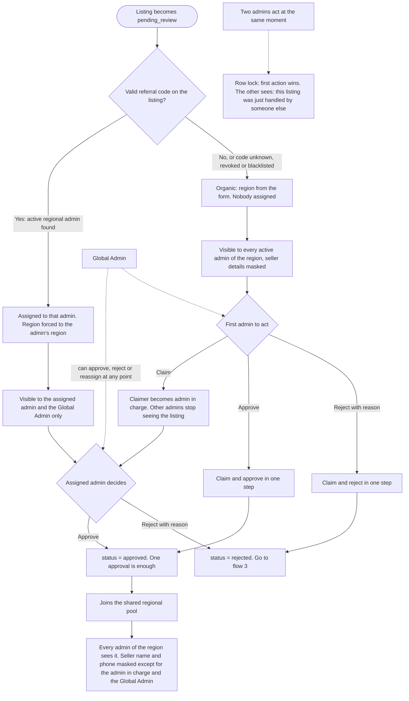
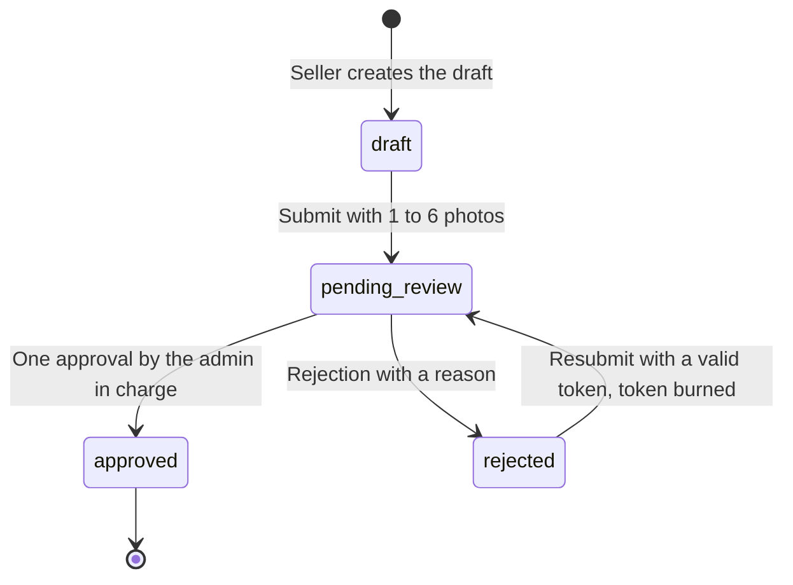
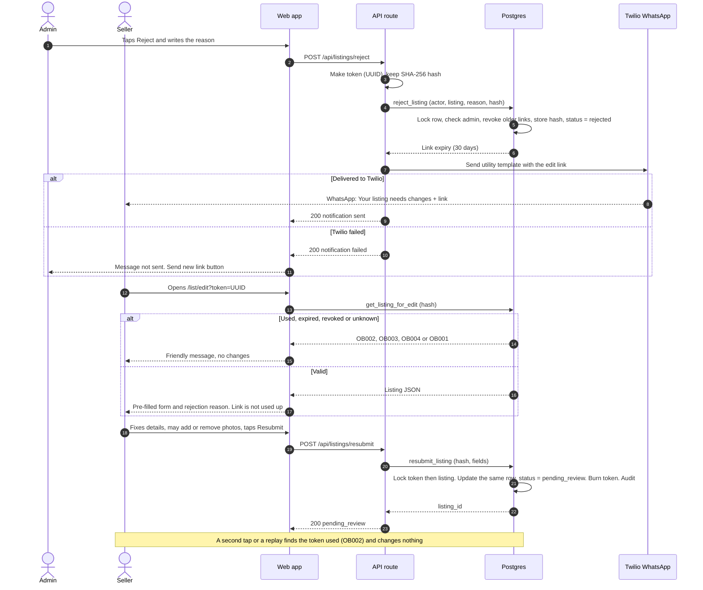
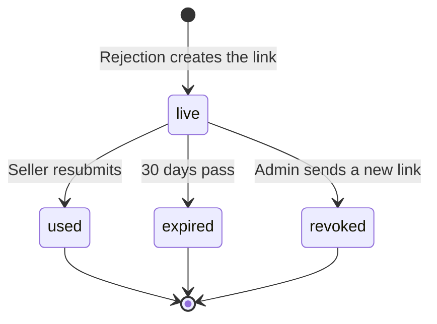
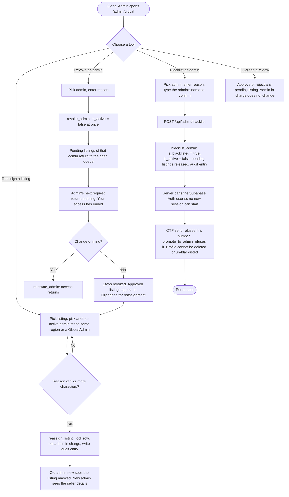

# 04 · User and Admin Flowcharts and State Machines

Project: OBN NATION ONLINE.COM · Phase 1, the Listing Cloud · Version 1.0 · 17 Oct 2026
Related: [02 PRD](02_PRD_PHASE_1.md) · [03 Database](03_ERD_AND_DATABASE_SCHEMA.md) · [07 API](07_API_CONTRACTS_AND_INTEGRATIONS.md)

All diagrams are Mermaid and render on GitHub, in VS Code and in most Markdown previews. Each diagram is followed by notes that tie the steps to requirement IDs in the PRD.

---

## 1. Seller ingestion and passwordless WhatsApp OTP

### 1.1 Sign-in sequence

Notes:

- The referral cookie is set before sign-in and is never cleared by it (SI-6). The server reads it later when the listing is created.
- The code is a WhatsApp message built from the approved authentication template. No code is ever shown on screen or written to a log (SI-10).
- A blacklisted number is refused at step 6 and again inside the hook, so a direct call to Auth cannot bypass it.

### 1.2 Listing submission

Notes: FM-1 to FM-10. Retrying never creates a second listing because the create call finds the draft by `(seller, client_key)`. Compression and the 60-second check happen on the phone before any upload.

## 2. Admin review, referral routing and consensus

"Consensus" in Phase 1 is a single sign-off. A referral listing is approved by its assigned admin. An organic listing is claimed and approved by the first reviewing admin of the region, or by the Global Admin.

Notes:

- AD-4 and AD-7 in the PRD. The lock lives in the database functions `claim_listing`, `approve_listing` and `reject_listing`.
- A Global Admin who approves an unclaimed listing becomes the admin in charge (DF-3). If the listing is already assigned, the assignment stays (DF-4).
- Revoking or blacklisting an admin sends that admin's pending listings back to the "organic" branch (DF-5).

## 3. Rejection, WhatsApp notice, token edit and resubmission

### 3.1 State machine

Illegal moves (for example `approved` back to `pending_review`) are refused by a database trigger.

### 3.2 Loop sequence

### 3.3 Edit-link life cycle

Only one link per listing is live at a time. Opening a live link does not change its state.

## 4. Global Admin: reassignment, revocation and blacklist

Notes: GA-3 to GA-8 in the PRD. If the Auth ban fails after the database flag is set, the flag alone already blocks all data access, and the route reports that the ban is being retried. Repeating a blacklist request is safe.

## 5. Where each flow is tested

| Flow | QA scenarios in [08](08_QA_TEST_CASES_AND_ACCEPTANCE.md) |
|---|---|
| 1.1 Sign-in | QA-01 to QA-04 |
| 1.2 Submission | QA-05 to QA-12 |
| 2 Review and routing | QA-13 to QA-18 |
| 3 Rejection loop and tokens | QA-19 to QA-25 |
| 4 Governance | QA-26 to QA-31 |
