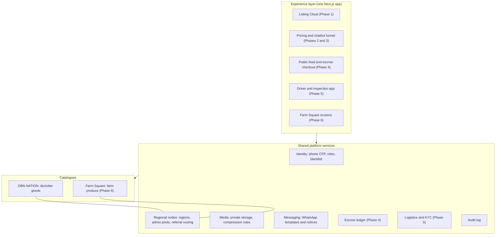
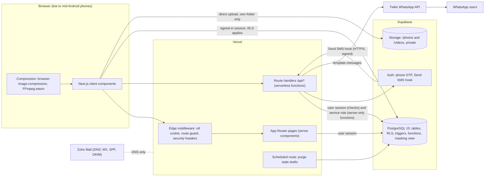
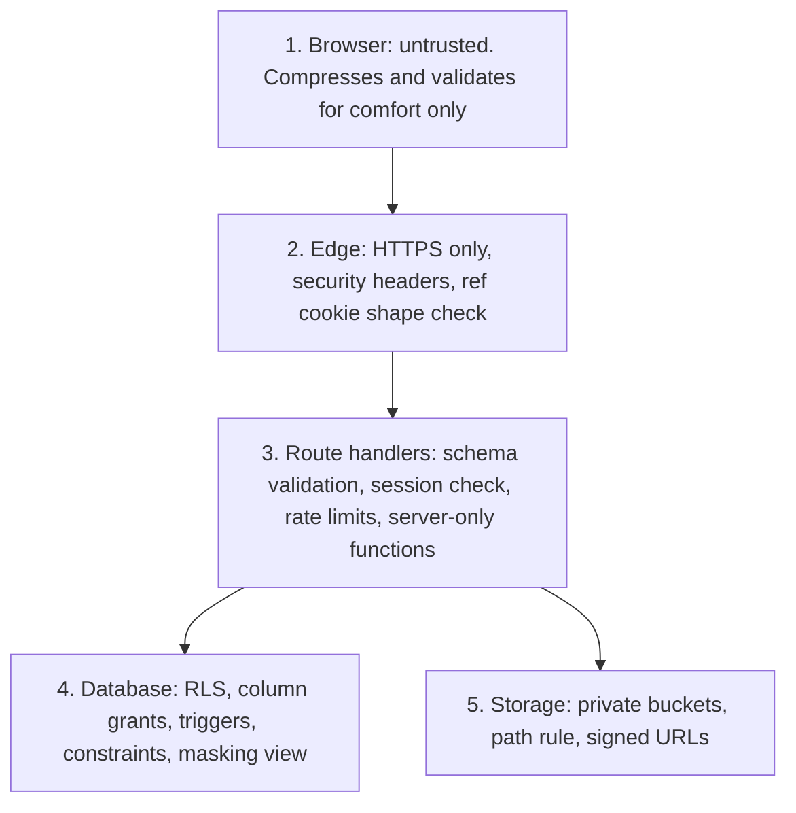

# OBN NATION Phase 1: single-file brief for any AI tool

Paste or upload this one file into any AI chat. It holds the agent rules, the PRD, the architecture, roles and permissions, the QA suite and the build plan. The database SQL and API code are in separate files in the repo (docs 03 and 07).


---

<!-- FILE: AGENTS.md -->

# AGENTS.md: read this first

Project: OBN NATION ONLINE.COM, Phase 1 (the Listing Cloud). A trust-verified marketplace for second-hand goods in Nigeria. Built by Ighodalo Labs.

## What Phase 1 is
Sellers sign in with a WhatsApp code, submit a listing (photos, optional video), and regional admins review it. Rejected sellers get a WhatsApp link to fix and resubmit. Approved listings join a regional pool where seller contacts are masked. A Global Admin governs everything.

## Where the truth is
Read in this order. Read only what your task needs.
1. `docs/phase-1/09_BUILD_PLAN_GOALS_AND_AGENT_LOOP.md`: the task list and the loop you must follow
2. `PROGRESS.md`: what is done, what is next, open gates, blockers
3. `docs/phase-1/02_PRD_PHASE_1.md`: requirements with IDs, brand, screens, business rules
4. `docs/phase-1/03_ERD_AND_DATABASE_SCHEMA.md` and `supabase/migrations/`: the data and the rules in SQL
5. `docs/phase-1/07_API_CONTRACTS_AND_INTEGRATIONS.md`: every endpoint, error codes, WhatsApp templates, compression code
6. `docs/phase-1/04` flows, `05` wireframes, `06` roles and permissions, `08` tests
7. `docs/phase-1/01_SYSTEM_ARCHITECTURE.md`: how the parts fit

If code and docs disagree, stop and report. Do not guess.

## Stack
Next.js 14 (App Router, TypeScript strict, Tailwind) on Vercel. Supabase: Postgres 15, Auth (phone OTP with a Send SMS hook), private Storage buckets `photos` and `videos`. Twilio WhatsApp. Browser-side compression (`browser-image-compression`, FFmpeg.wasm self-hosted in `public/ffmpeg`).

## Hard rules
1. The database enforces the rules (RLS, triggers, functions). The app never replaces that. Do not weaken a policy to make a screen work.
2. Never edit an applied migration. Add a new numbered file in `supabase/migrations/`.
3. Run the SQL tests after any change in `supabase/` (steps in doc 03). All 92 must pass.
4. The service-role key is used in server code only. It must never reach the browser.
5. Edit tokens: a random UUID goes to the seller, only its SHA-256 hash is stored. Never log a token or an OTP.
6. Masking: seller name and phone are masked everywhere except for the admin in charge and the Global Admin. Use the view `regional_listings_feed`.
7. Creating a listing must be idempotent through `(seller_id, client_key)`. A retry or a resubmit never inserts a second row.
8. Photos are WebP under 1 MB. Videos are MP4 under 10 MB and at most 60 seconds. Compress on the phone before upload.
9. Brand colours as fills with white text. Check contrast with the table in PRD 2.2.
10. No secrets in the repo. Use `.env.local` (copy `.env.example`).

## Commands
- Install and run: `cd apps/web && npm install && npm run dev`
- Checks: `npm run check` (typecheck, lint), `npm test`
- SQL tests: see doc 03, section 10 "Running the tests"

## Working style
- One task per session loop. Small commits on `feat/*` branches off `dev`.
- Write the test first when the task has logic.
- After each task: update `PROGRESS.md`, then stop and report what changed, what passed, and what the human must do next.
- Stop at a human gate or after 3 failed attempts on the same error. Write the blocker in `PROGRESS.md`.
- Keep answers short and in plain language.


---

<!-- FILE: docs/phase-1/09_BUILD_PLAN_GOALS_AND_AGENT_LOOP.md -->

# 09 · Build Plan, Goals (OKRs) and the Agent Loop

Project: OBN NATION ONLINE.COM · Phase 1, the Listing Cloud · Version 1.0 · 17 Oct 2026
Related: [02 PRD](02_PRD_PHASE_1.md) · [07 API](07_API_CONTRACTS_AND_INTEGRATIONS.md) · [08 QA](08_QA_TEST_CASES_AND_ACCEPTANCE.md) · `../../AGENTS.md` · `../../PROGRESS.md`

This document is the work plan. It is written for a person and for an AI coding tool. The tool reads `AGENTS.md` first, then picks the next unchecked task in `PROGRESS.md`.

---

## 1. Goals (OKRs)

### O1 · Ship the core loop by the end of week 4
A seller can sign in, submit a listing, get rejected, fix it and resubmit. An admin can claim, approve and reject. A Global Admin can govern.

| KR | Target | How we check |
|---|---|---|
| KR1.1 | Tasks T01 to T17 are done and section 2 (M1 complete) is true by 15 Nov 2026 | `PROGRESS.md` |
| KR1.2 | QA scenarios QA-01 to QA-31 pass on a staging deploy | Doc 08 |
| KR1.3 | One full loop (submit, reject, WhatsApp link, edit, resubmit, approve) works on a real phone | Manual run, recorded |

### O2 · Keep quality high from day one
| KR | Target | How we check |
|---|---|---|
| KR2.1 | 92 of 92 database checks pass on every change to `supabase/` | CI job `db-tests` |
| KR2.2 | Zero TypeScript errors in strict mode, zero lint errors | CI job `check` |
| KR2.3 | No secret in the repo. Service key never reaches the browser | Secret scan in CI, review of the client bundle |
| KR2.4 | Photo under 1 MB and video under 10 MB on the three test phones | Doc 08 section 2.2 |

### O3 · Meet the Phase 1 gate during closed beta (weeks 5 to 8)
| KR | Target | How we check |
|---|---|---|
| KR3.1 (G1) | 100% of manual Xender and WhatsApp routing removed | Global Admin confirms. Zero manual intake in the last 14 days |
| KR3.2 (G2) | At least 500 reject-edit-resubmit loops delivered automatically | Count of `audit_log` rows with action `listing.resubmit` |
| KR3.3 (G3) | Zero duplicate listings from resubmits | Query in doc 08, group G3 |

### O4 · Unblock the client side early
| KR | Target | Owner |
|---|---|---|
| KR4.1 | Meta business verification started in week 1 | OBN NATION |
| KR4.2 | Both WhatsApp templates approved before week 3 | OBN NATION |
| KR4.3 | Domain DNS access in hand before week 4 | OBN NATION |
| KR4.4 | Transparent PNG or SVG logo received before week 4 (JPG and About Us text are already in) | OBN NATION |

---

## 2. Milestone 1: what "complete" means

Milestone 1 (weeks 1 to 4) is complete when **every line below is true**. The person who signs it off is the Global Admin for the product side, and the CTO's office for the payment release.

### 2.1 What must work (from PRD section 8)

| # | M1 deliverable | Tasks | Proof |
|---|---|---|---|
| 1 | Database and security rules live on the real Supabase project | T02 | 92 of 92 checks pass. Migrations 0001 and 0002 applied |
| 2 | Passwordless WhatsApp sign-in for sellers and admins | T03 to T06 | QA-01 to QA-04 pass |
| 3 | Three-step listing form with on-phone compression and upload | T07 to T09 | QA-05 to QA-12 pass. Photo under 1 MB, video under 10 MB |
| 4 | Referral links and regional routing | T04, T10 | Listing from `?ref=` is assigned to that admin. QA-13 and QA-14 pass |
| 5 | Admin dashboard: claim, single approval, reject with reason | T11 | QA-15 to QA-18 pass. Two admins at once: the first wins |
| 6 | Rejection WhatsApp, 30-day edit link, resubmit | T12, T13 | QA-19 to QA-25 pass |
| 7 | Shared regional pool with masked seller details | T14 | Masking confirmed in the app and in the database |
| 8 | Global Admin screens: reassign, revoke, reinstate, create admin, blacklist | T15 | QA-26 to QA-31 pass |
| 9 | Landing page with the client's About Us text, and Zoho Mail DNS | T16 | Page live on the domain. Mail records verified |
| 10 | Draft cleanup, error pages, empty states | T17 | Every route has loading, empty and error states |

### 2.2 Quality bar

- `npm run check` and `npm test` pass with no errors.
- The SQL tests pass in CI on every change in `supabase/`.
- No secret in the repository. The service-role key is not in the browser bundle.
- The app is deployed to a staging URL on Vercel.
- The WhatsApp sender can be the stub until Meta approves the templates. Live WhatsApp is checked in Milestone 2 (T20).

### 2.3 The one end-to-end run

On a real Android phone, on the staging URL, someone completes this without help:

1. Open an admin's referral link and sign in with a code.
2. Submit a listing with 3 photos and 1 video.
3. As the admin, reject it with a reason.
4. Open the edit link, fix the listing, resubmit.
5. As the admin, approve it.
6. As another admin of the same region, see it in the pool with the seller masked.
7. As Global Admin, reassign it, then revoke and reinstate an admin.

Record the run (screen recording). Keep it in the repo's `docs/evidence/` folder or the project drive.

### 2.4 Sign-off

| Step | Who | Done when |
|---|---|---|
| Demo of the end-to-end run | Developer | Recording shared with the client |
| Client acceptance of M1 | Global Admin | Written yes in WhatsApp or email |
| Payment release for M1 | CTO's office | Per the cost proposal: funds are released on confirmation |
| Pro plans started | Developer | Supabase Pro and Vercel Pro active at the start of M2, as the CTO required |

M1 is **not** complete while any Must requirement in section 6 of the PRD for these routes fails its test in doc 08.

### 2.5 Target dates

These assume the Supabase, Vercel and Twilio accounts exist by Thursday 22 Oct 2026. Each day the accounts are late moves every date by one day.

| Week | Dates (2026) | Tasks | Ends with |
|---|---|---|---|
| 1 | 20 to 25 Oct | T01 to T06 | A phone signs in with a code |
| 2 | 26 Oct to 1 Nov | T07 to T10 | A seller submits a listing with media |
| 3 | 2 to 8 Nov | T11 to T14 | Full loop: submit, reject, edit, resubmit, approve |
| 4 | 9 to 15 Nov | T15 to T17 | Everything in section 2.1 works on staging |
| Sign-off | 16 to 18 Nov | Demo and acceptance | M1 accepted. M2 starts |

---

## 3. Work breakdown

Each task is small enough for one AI session and one commit. "Docs" lists what the tool must read. "Done when" is the check that closes the task.

### Week 1 · Foundation and sign-in

| ID | Task | Docs | Done when |
|---|---|---|---|
| T01 | Create the Next.js 14 app in `apps/web` (App Router, TypeScript strict, Tailwind). Load the brand tokens from PRD 2.2. Add lint, typecheck and test scripts | 02 s2, 01 | `npm run check` passes. Home page shows the wordmark in brand colours |
| T02 | Create the Supabase project. Apply `0001` and `0002`. Add the CI job that runs the SQL tests | 03, `supabase/` | CI shows 92 of 92 checks passing |
| T03 | Env validation and the three Supabase clients (browser, server with user session, server with service role) | 01, 07 s1 | App fails fast with a clear message if a variable is missing. Service key is only imported in server files |
| T04 | Edge middleware: set the `obn_ref` cookie (8 hex, 30 days, HttpOnly), guard `/admin/*` and `/list/form` | 02 s6.2, 06 | Unit tests for cookie rules and redirects |
| T05 | `lib/whatsapp.ts` with a stub sender (logs to server console in dev only). Routes `POST /api/auth/otp/send`, `/verify`, and the hook `POST /api/hooks/send-otp` | 07 s3.1, s3.2, s3.11, s5 | Phone signs in with the stub code. Blacklisted phone is refused. QA-01 to QA-04 pass |
| T06 | `/list` page and `PATCH /api/profile/name` | 02 s6.2, 05 | New seller is asked for a name once, then lands on `/list/form` |

### Week 2 · Listing form and upload

| ID | Task | Docs | Done when |
|---|---|---|---|
| T07 | Three-step form UI with field rules and error messages. Draft kept in memory between steps | 02 s6.3, 05 | Step rules match PRD. Keyboard and phone layout work |
| T08 | Compression: wire `images.ts` and `video.ts`. Self-host FFmpeg files by `postinstall` | 07 s6, s9 | A 6 MB photo becomes WebP under 1 MB. A 60 s clip becomes MP4 under 10 MB. Video over 60 s is refused |
| T09 | `POST /api/listings/create` (draft then submit), signed uploads, "Under review" screen, retry with the same `client_key` | 07 s3.3, 04 s1.2 | QA-05 to QA-12 pass. Retry never makes a second row |
| T10 | Referral: region locked from the cookie, assignment on submit | 02 s5, 06 | A listing sent through `?ref=` shows the admin's region and is assigned to that admin |

### Week 3 · Admin loop

| ID | Task | Docs | Done when |
|---|---|---|---|
| T11 | Admin sign-in and `/admin/dashboard`: inbox from `regional_listings_feed`, claim and approve | 02 s6.5, 03 | QA-13 to QA-18 pass. Two admins acting together: the first wins |
| T12 | Reject modal, `POST /api/listings/reject`, WhatsApp notice, `POST /api/listings/reissue` | 07 s3.4, s3.8, 04 s3 | Rejection needs a reason of 5 to 500 characters. A failed message shows "Send new link" |
| T13 | `/list/edit?token=`: pre-filled form, `upload-url`, `resubmit` | 02 s6.4, 07 s3.5, s3.9 | QA-19 to QA-25 pass. A used, expired or replaced link shows a friendly message |
| T14 | `/admin/pool` with masking | 02 s6.6 | Seller name and phone are masked unless you are the admin in charge or a Global Admin |

### Week 4 · Governance, landing page, polish

| ID | Task | Docs | Done when |
|---|---|---|---|
| T15 | `/admin/global`: reassign, revoke, reinstate, create admin, blacklist (server bans the Auth user) | 02 s6.7, 07 s3.6, s3.10 | QA-26 to QA-31 pass |
| T16 | Landing page `/` with About Us. Zoho DNS records | 02 s3, s6.1 | Page is live on the domain. Mail records verified |
| T17 | `GET /api/cron/purge-drafts`, error pages, empty states, accessibility pass | 07 s3.12, 02 s7 | All routes have loading, empty and error states. Contrast table respected |

### Weeks 5 to 8 · Milestone 2

| ID | Task | Done when |
|---|---|---|
| T18 | Automate the QA scenarios as Playwright end-to-end tests where they can be automated | Suite runs in CI against staging |
| T19 | Test on three cheap Android phones. Fix what breaks | Doc 08 section 2.6 signed off |
| T20 | Upgrade to Supabase Pro and Vercel Pro. Switch the WhatsApp sender from stub to the approved templates | Production checks pass |
| T21 | Closed beta, go-live, measure G1 to G3 | Doc 08 section 3 filled in |

---

## 4. Human gates (the tool must stop and ask)

An AI tool cannot do these. Each one needs you or the client.

| Gate | Needed by | Who |
|---|---|---|
| Create Supabase, Vercel and Twilio accounts and give the tool the keys through `.env.local` (never in chat) | T02 | You |
| Push the repository to GitHub | Before T02 CI | You (`Desmath3`) |
| Meta verification and the two template approvals | T20 (stub is used before) | Client |
| Domain DNS access | T16 | Client |
| Transparent PNG or SVG logo | T16 | Client |
| Answer: is video optional or required? | T07 | Client, through you |
| First Global Admin signs in once, then run `bootstrap_global_admin('+2348053466836')` | T11 | You |
| Real-phone checks: WhatsApp delivery, compression, two admins at once | T19 | You |
| Any change to a business rule in PRD section 5 | Any time | Client, through you |

---

## 5. The agent loop

One loop, repeated for each task. It works the same in Claude Code and in Antigravity.

```
PICK    Take the first unchecked task in PROGRESS.md whose gate is clear.
READ    Read AGENTS.md, the task row above, and only the docs it lists.
PLAN    Write 5 to 10 lines: files to touch, tests to add, risks. Save to PROGRESS.md under "Current".
TEST    Write the failing test first when the task is code with logic.
BUILD   Make the smallest change that passes. Follow the rules in AGENTS.md.
CHECK   Run: npm run check, npm test, and the SQL tests if supabase/ changed.
REVIEW  Compare the change line by line with the requirement IDs. List anything not covered.
FIX     If a check fails, fix it. After 3 failed attempts on the same error, stop and write a BLOCKER.
SAVE    Commit on a feat/* branch. Update PROGRESS.md: tick the task, add the commit, note surprises.
STOP    If the next task is behind a human gate, stop and say exactly what is needed.
```

### 5.1 Rules for the loop

1. One task per loop. Do not start the next task before the commit.
2. The docs in `docs/phase-1/` are the truth. If code and docs disagree, stop and report. Do not guess and do not silently edit the docs.
3. Never change an applied migration. Add a new numbered migration.
4. Never put a secret in code, logs or chat. Keys live in `.env.local` and the host dashboards.
5. Never show a plain edit token or an OTP in a log or a response.
6. Keep every change testable. If you cannot test it, say why.
7. Ask a human only at a gate or a BLOCKER. Otherwise decide, and write the decision in `PROGRESS.md`.

### 5.2 Prompt to start a session

Paste this into Claude Code or Antigravity:

```
Read AGENTS.md. Then run the agent loop in docs/phase-1/09_BUILD_PLAN_GOALS_AND_AGENT_LOOP.md section 5.
Work on the next unchecked task in PROGRESS.md. Stop after that one task is committed
and tell me: what changed, what passed, what I must do next.
```

### 5.3 Prompt to run a longer stretch

```
Read AGENTS.md. Run the agent loop on the next tasks in PROGRESS.md, one at a time,
until you reach a human gate or a BLOCKER. After each task, commit and update PROGRESS.md.
At the end, give me a short report: tasks done, tests run, anything I must decide.
```

### 5.4 Prompt for a review pass (use a second session)

```
Read AGENTS.md. Do not write code. Review the last commit against the requirement IDs in the docs
it cites. List gaps, security problems and missing tests, most serious first.
```

A fresh session for review gives a view that is not tied to the builder's reasoning.

---

## 6. Weekly check-in (for you)

At the end of each week, answer four questions in `PROGRESS.md`:

1. Which KRs moved?
2. What blocked us, and who owns the next step?
3. Did any client answer change a rule? If yes, which doc changed?
4. What is the one outcome for next week?


---

<!-- FILE: docs/phase-1/02_PRD_PHASE_1.md -->

# 02 · Product Requirements Document: Phase 1, the Listing Cloud

Project: OBN NATION ONLINE.COM · Client: OBN NATION · Director and Global Admin: Aghughu Omo-Odion Destiny
Owner: Ighodalo Labs · Developer: Bassey · Version 1.0 · 17 Oct 2026
Related: [01 Architecture](01_SYSTEM_ARCHITECTURE.md) · [03 Database](03_ERD_AND_DATABASE_SCHEMA.md) · [04 Flows](04_USER_AND_ADMIN_FLOWCHARTS.md) · [05 Wireframes](05_UI_WIREFRAMES_AND_IA.md) · [06 RBAC](06_RACI_AND_RBAC_MATRIX.md) · [07 API](07_API_CONTRACTS_AND_INTEGRATIONS.md) · [08 QA](08_QA_TEST_CASES_AND_ACCEPTANCE.md)

Priority labels: **Must** = needed for the Phase 1 gate. **Should** = included in the build if time allows inside Milestone 1.

---

## 1. Executive summary

OBN NATION is a trust-verified marketplace for second-hand goods in Nigeria. Today the business runs by hand. Sellers send photos and details over WhatsApp. Admins move files between phones with Xender, retype details and post them to groups. This is slow, error-prone and tiring for admins, and seller phone numbers travel loosely, so there is no control over who can see them.

Phase 1, the **Listing Cloud**, replaces that routine with one pipeline:

1. A seller signs in with a WhatsApp code (no password) and fills a three-step form with photos and an optional video.
2. The listing goes to the right regional admin for review. One approval from the admin in charge makes it live.
3. If something is wrong, the admin rejects it with a reason. The seller gets a WhatsApp message with a private link, fixes the same listing and resubmits. The link works once.
4. Approved listings join a shared regional pool that every admin in that region can see and advertise. Seller name and phone stay hidden from everyone except the admin in charge and the Global Admin. The database enforces this, not the screen.

### 1.1 Problem statement

| Today | Effect |
|---|---|
| Intake by WhatsApp and Xender | Files get lost, duplicated or mixed between sellers |
| Admins retype and repost | Hours of admin time and typing mistakes |
| No review rule | Quality depends on whoever posts |
| Phone numbers shared freely | Admins can leave and take sellers with them. No audit trail |
| Rejections done by chat | No tracking, no way to prove a listing was fixed |

### 1.2 Goals and the Phase 1 gate

The blueprint says Phase 2 starts only when Phase 1 meets these targets:

| Gate | Target | How it is measured |
|---|---|---|
| G1 | 100% of internal Xender and WhatsApp file routing removed | Admin confirmation and zero manual intake in the last 14 days of beta |
| G2 | At least 500 reject-edit-resubmit loops delivered automatically | `count(*)` of `audit_log` rows with action `listing.resubmit` |
| G3 | Zero duplicate listings from resubmits | `listings` per `(seller_id, client_key)` is unique, and resubmit never inserts. Verified by query and by the QA suite |

### 1.3 Out of scope

Pricing engine, chatbot, public item feed, escrow and payments, logistics, Farm Square and translations (Phases 2 to 6). A seller status page and an approval notice by WhatsApp are not in Phase 1 either; the only WhatsApp messages are the OTP and the rejection notice. Meta business verification and WhatsApp template approval are the client's responsibility.

## 2. Brand specification

### 2.1 Identity

| Item | Value |
|---|---|
| Name | OBN NATION (One Beta Nation) |
| Tagline | Connecting People ❤️💚💙 |
| Full lockup | OBN NATION — Connecting People ❤️💚💙 |
| Voice | Professional, friendly, approachable, trustworthy and community-oriented. Clear, human and persuasive without exaggeration. Short sentences. No jargon on seller screens |
| Colour meaning | Red: action, urgency and speed. Green: growth, financial freedom and agricultural roots. Blue: trust, verification and community stability. Use all three consistently |
| Language | English only in Phase 1 |

### 2.2 Colour tokens

Dark theme. Background `#0A0A0A`. The three brand colours are fills for buttons and badges with white text. They are **not** used as text on the dark background, because their contrast there is below 4.5:1. Where a brand colour must appear as text or an outline on dark, use the light tint.

| Token | Hex | Role | Contrast with white text on it | Contrast of the colour on `#0A0A0A` |
|---|---|---|---|---|
| `--color-bg` | `#0A0A0A` | Page background | n/a | n/a |
| `--color-surface` | `#171717` | Cards, sheets | white on it 17.9:1 | n/a |
| `--color-text` | `#FFFFFF` | Main text | 19.8:1 on background | n/a |
| `--color-text-muted` | `#A3A3A3` | Help text, labels | n/a | 7.9:1 |
| `--color-red` | `#D32F2F` | Primary action, reject, errors | 5.0:1 | 4.0:1 (large text and icons only) |
| `--color-green` | `#2E7D32` | Success, approve, "live" badge | 5.1:1 | 3.9:1 (large text and icons only) |
| `--color-blue` | `#1565C0` | Links in buttons, info, selected card border | 5.7:1 | 3.4:1 (large text and icons only) |
| `--color-red-tint` | `#EF5350` | Red text and outlines on dark | n/a | 5.7:1 |
| `--color-green-tint` | `#66BB6A` | Green text and outlines on dark | n/a | 8.4:1 |
| `--color-blue-tint` | `#42A5F5` | Blue text and outlines on dark | n/a | 7.5:1 |
| `--color-border` | `#2A2A2A` | Dividers, input outlines | n/a | n/a |

Usage rules:

- One primary action per screen, in `--color-red` with white text. The sticky "List an item" button on the landing page is red.
- Approve is green. Reject is red. Neutral actions are outlined in `--color-border`.
- Selected condition cards use a `--color-blue-tint` border and a blue-tinted fill.
- Never use colour alone to carry meaning. Every status also has a text label and an icon.

### 2.3 Type and layout

| Item | Rule |
|---|---|
| Font | System font stack (`system-ui, -apple-system, "Segoe UI", Roboto, sans-serif`). No web font download on slow networks |
| Sizes | Body 16px minimum. Headings 22 to 28px. Buttons 16px, semi-bold |
| Layout | Single column. Maximum content width 480px, centred on larger screens |
| Touch targets | At least 48 by 48px |
| Spacing | 8px grid. 16px screen gutter |
| Logo | Received 17 Oct 2026: `apps/web/public/brand/obn-logo-on-black.jpg` (flat JPG on black). The header shows the logo with the tagline beneath. A transparent PNG or SVG is still requested. The logo's own colours are darker than the screen tokens above; the tokens are tuned for contrast on dark. Fonts: the client asks for a clean, modern font that suits the logo. Phase 1 keeps the system font stack for speed on slow networks; revisit in Phase 2 |
| Motion | Short fades only. Respects "reduce motion" |

## 3. Gateway "About Us" copy

This is the client's own text (message B4, 15 Oct 2026). Use it word for word.

> **About OBN NATION**
>
> OBN NATION (One Beta Nation) is a Nigerian community-driven decluttering and asset-liquidation marketplace and advertising company. We connect people with products, services, opportunities and trusted transactions by helping individuals and businesses turn unused assets into value.
>
> Through our community networks, advertising channels and associate network, we help sellers reach potential buyers while making quality, affordable items more accessible to our communities. Our model combines community commerce, marketing and trust-focused transaction support.
>
> We believe that trust is an asset, reputation is capital, and integrity is a long-term business strategy. Our mission is to make buying, selling and decluttering easier by connecting people and creating value within our communities.

Button label: **List an item**.

## 4. Personas

| Persona | Who they are | What they need | Sees |
|---|---|---|---|
| **Guest Seller** | Someone in Port Harcourt, Delta or Ekiti with an item to sell. Uses a low-to-mid Android phone on a slow network. May arrive from an admin's link | List fast. No password. Fix a rejection without starting over | Own listings and their status only |
| **Attributed Regional Admin** | The regional admin **in charge** of a given listing: the one whose referral link was used, or who first claimed or approved it | Review quickly. See the seller's name and phone. Keep the sale | Full seller details for listings they are in charge of |
| **Non-Attributed Regional Admin** | Any other admin in the same region | See the region's approved stock so they can advertise it. Review unclaimed listings | Same listings, but seller name and phone are masked (`A***`, `+234 ••• ••• ••36`) |
| **Global Admin** | Aghughu Omo-Odion Destiny (08053466836) | Oversee everything. Reassign listings if an admin goes missing. Revoke or blacklist admins | Everything, unmasked, across all regions |

The words "attributed" and "non-attributed" always describe the relationship between **one admin and one listing**. The same person is attributed on some listings and non-attributed on others.

## 5. Business rules (decided by the client)

| # | Rule |
|---|---|
| BR-1 | Regions on day one: Port Harcourt, Delta, Ekiti |
| BR-2 | Categories: Phones, Computers, TVs, Fridges, Generators, Kitchen, Furniture, Other |
| BR-3 | The form has three steps. Photos: 1 to 6, each under 1 MB, WebP. Video: optional, 0 or 1, at most 60 seconds, under 10 MB, MP4 |
| BR-4 | A listing from an admin's referral link (`?ref=`) is single-approval by that admin |
| BR-5 | A listing without a referral link is organic. The first reviewing regional or global admin claims it and approves it |
| BR-6 | Rejection needs a reason. The seller gets a WhatsApp message through Twilio with a single-use edit link valid for 30 days. The link is not used up by opening it. It is burned when the seller resubmits |
| BR-7 | Resubmitting never creates a second record |
| BR-8 | In the approved regional pool, seller phone and name are masked for every admin who is not in charge of that listing |
| BR-9 | The Global Admin can override, reassign listings and permanently blacklist admins |
| BR-10 | Seller sign-in is by WhatsApp OTP only. No passwords |

**Contacts from the client (17 Oct 2026).** Delta: +234 814 715 2732. Ekiti: +234 916 238 8282. OBN NATION (main): +234 707 276 7227. Global Admin: Aghughu Omo-Odion Destiny, +234 805 346 6836. The client has not said which region the main number belongs to or which of these people are regional admins. Confirm before creating admin accounts (T11).

### 5.1 Defaults set by the build team (confirm during beta)

These were not specified, so the build uses the safest simple choice. Each is a setting or a one-line change.

| # | Default | Why |
|---|---|---|
| DF-1 | A referral listing always takes the referring admin's region, even if the seller picks another | The admin can only review their own region. The form locks the region when a link is used |
| DF-2 | Rejecting an unclaimed listing makes the rejecting admin the admin in charge | They are the first reviewing admin (BR-5) |
| DF-3 | A Global Admin who approves an unclaimed listing becomes the admin in charge | Someone must hold the seller contact. They can reassign afterwards |
| DF-4 | A Global Admin may approve or reject a listing assigned to another admin (override). The assignment does not change | BR-9 |
| DF-5 | Revoking or blacklisting an admin returns their **pending** listings to the open queue. Their **approved** listings stay assigned until the Global Admin reassigns them | Keeps contacts safe and the queue moving |
| DF-6 | Revocation can be undone (reinstate). Blacklisting cannot | "Permanent" for blacklist |
| DF-7 | An expired edit link can be replaced by the admin in charge or the Global Admin ("Send new link"). Older links stop working | Avoids a dead end after 30 days |
| DF-8 | A seller can create at most 10 new listings in 24 hours | Stops spam and runaway scripts |
| DF-9 | Drafts older than 7 days are deleted along with their files | Keeps storage clean |
| DF-10 | Sellers enter their name once, right after their first code, because the masked form needs a first letter | Required for `A***` |
| DF-11 | Phone numbers must be Nigerian (+234) in Phase 1 | Matches the three regions |
| DF-12 | Price is in naira, whole naira, from ₦1 to ₦1,000,000,000 | Sensible bounds |
| DF-13 | Admins are added by the Global Admin using the admin's phone number and region. The admin then signs in with a WhatsApp code like everyone else | No second login system |
| DF-14 | Content cannot change while a listing is under review or live | Prevents edits after approval |
| DF-15 | Every WhatsApp message (sign-in code and rejection notice) is sent from one sender: the OBN NATION number +234 707 276 7227 (client, 17 Oct 2026) | One trusted sender. The number must be registered with Meta and Twilio for the API. If it is still in use on the normal WhatsApp app, the client must move it first (see section 9) |
| DF-16 | Video is optional, 0 or 1 (client confirmed, 17 Oct 2026) | Cheap phones struggle with video |

## 6. Functional requirements

Common rules for all routes:

- Every screen works as a single column on a 360px-wide phone.
- Every error message says what happened and what to do next, in plain words.
- Every submit button is disabled while its request is running, so double taps do nothing.
- Every request that fails because of the network shows a retry button and keeps what the user typed.

### 6.1 Route `/`: Gateway landing page and DNS

**Purpose.** Introduce OBN NATION and send people to the Listing Cloud. Static page, no data calls, works without sign-in.

| ID | Priority | Requirement |
|---|---|---|
| LP-1 | Must | Show the header (logo and tagline), the "About OBN NATION" card with the copy in section 3, and a sticky bottom button "List an item" that goes to `/list` |
| LP-2 | Must | The page is fully static. Largest content render under 2.5 seconds on a throttled slow-4G profile. No script is needed to read it |
| LP-3 | Must | If the URL has `?ref=CODE`, the middleware stores the code (section 6.2) and the page itself looks the same. The button keeps the code |
| LP-4 | Must | Page title "OBN NATION — Connecting People". Description meta tag with the first sentence of the About copy. Open Graph title and description set |
| LP-5 | Must | No working-screen text is added here. Long company text lives only on this page and is linked as "About" from other screens (blueprint rule) |

**Inputs.** Optional query `ref`. **Errors.** None; the page is static. An invalid `ref` is ignored silently.

**Zoho Mail DNS specification (FR-DNS)**

| ID | Priority | Requirement |
|---|---|---|
| DNS-1 | Must | Website records: apex `A` record to `76.76.21.21`, `www` `CNAME` to `cname.vercel-dns.com`, as Vercel shows in the project's domain settings at the time of setup |
| DNS-2 | Must | `MX` records to Zoho at priorities 10, 20 and 50 (`mx.zoho.com`, `mx2.zoho.com`, `mx3.zoho.com` for accounts in the Zoho `.com` data centre). If the client's Zoho account is in another data centre, use the hosts Zoho shows for that centre |
| DNS-3 | Must | `TXT` SPF on the apex: `v=spf1 include:zoho.com ~all` (matching the data centre, as Zoho shows) |
| DNS-4 | Must | `TXT` DKIM at the selector Zoho generates, for example `zmail._domainkey`, with the public key value copied from the Zoho admin console |
| DNS-5 | Must | `TXT` domain verification record that Zoho gives at setup |
| DNS-6 | Should | `TXT` DMARC at `_dmarc` with policy `v=DMARC1; p=none` first, tightened after two clean weeks |
| DNS-7 | Must | Acceptance: send a mail to and from a Zoho mailbox on the domain. In the received message headers SPF and DKIM both show PASS. The website still loads |

### 6.2 Route `/list`: Passwordless WhatsApp OTP entry

**Purpose.** The only door for sellers and admins. Collect the phone number, send a WhatsApp code, verify it, and keep the referral code through the whole process.

| ID | Priority | Requirement |
|---|---|---|
| SI-1 | Must | Show a phone field (Nigerian number) and a "Send code" button. Accept `0803…`, `803…` and `+234803…`; store as `+234803…` |
| SI-2 | Must | On send, the server checks the number is not blacklisted, then sends a 6-digit code as a WhatsApp message. The screen changes to a code field and a "Resend" button that unlocks after 60 seconds |
| SI-3 | Must | Correct code signs the user in. The next screen depends on the situation (see table below) |
| SI-4 | Must | No password field, no email field, no account page, ever |
| SI-5 | Must | The code is valid for 10 minutes. After 5 wrong tries the code is void and a new one must be requested |
| SI-6 | Must | **Referral persistence.** If the visitor arrives with `?ref=CODE` on `/` or `/list`, the middleware checks the code matches `^[a-f0-9]{8}$` and stores it in an HttpOnly, Secure, SameSite=Lax cookie `obn_ref` for 30 days. It survives the code step, a page refresh and a closed tab. A newer valid link replaces the older code. The code is read only on the server when the listing is created |
| SI-7 | Must | A first-time seller is asked for their name (2 to 80 characters) right after the code. The name is saved to their profile and is not asked again |
| SI-8 | Must | Admins sign in here too. If the visitor was sent from `/admin/*`, a `next` value returns them there after sign-in. Signed-in admins who open `/list` see a link "Go to admin" above the form |
| SI-9 | Must | A blacklisted number never receives a code. The screen says "This number cannot be used on OBN NATION." |
| SI-10 | Must | The WhatsApp code message uses the approved authentication template. If Twilio is down, the screen says the code could not be sent and offers retry. It never shows the code |

**Where each user goes after sign-in**

| User | Destination |
|---|---|
| Seller with a name | `/list/form` |
| Seller without a name | Name step, then `/list/form` |
| Regional or Global Admin with `next` | The `next` page |
| Regional or Global Admin without `next` | `/admin/dashboard` |

**Validation and error states**

| Situation | Message | HTTP |
|---|---|---|
| Not a Nigerian number | "Enter a Nigerian phone number, for example 0803 123 4567." | 400 |
| Blacklisted number | "This number cannot be used on OBN NATION." | 403 |
| Asked again within 60 seconds | "Please wait {n} seconds before asking for a new code." | 429 |
| Too many sends | "Too many tries. Please try again in 10 minutes." | 429 |
| Wrong code | "That code is not right. {k} tries left." | 400 |
| Code expired or void | "This code has expired. Ask for a new one." | 410 |
| WhatsApp could not deliver | "We could not send the code. Check your number and try again." | 502 |

**Edge cases.** The visitor changes the number after sending: the old code is void. The visitor has no WhatsApp on that number: the message cannot be delivered and the 502 message shows; the number must be a WhatsApp number (stated beneath the field). Two tabs open: the later sign-in wins and both stay signed in. An existing admin number used as seller: allowed, they sign in as their role.

### 6.3 Route `/list/form`: Three-step progressive form

**Purpose.** Capture the listing in three short steps. Each step appears only after the previous one is complete (progressive disclosure).

**Access.** Signed-in users with a name. Others are redirected to `/list`.

**Fields**

| Step | Field | Type | Rules |
|---|---|---|---|
| 1 | Region | Three large buttons: Port Harcourt, Delta, Ekiti | Required. Locked and pre-set when a valid referral code is active (DF-1) |
| 1 | Category | Eight icon tiles: Phones, Computers, TVs, Fridges, Generators, Kitchen, Furniture, Other | Required |
| 2 | Title | Text | Required, 3 to 80 characters |
| 2 | Description | Text area | Required, 10 to 1000 characters. Character counter shown |
| 2 | Brand | Text | Optional, 1 to 60 characters |
| 2 | Model | Text | Optional, 1 to 60 characters |
| 2 | Size | Text | Optional, 1 to 60 characters (for example "43 inch" or "2.5 kVA") |
| 2 | Age of item | Five radio cards with icons: New, sealed · New, open box · Premium used · Neatly used · Fairly used | Required |
| 2 | Working status | Three radio cards with icons: Working perfectly · Minor issues · Not working | Required |
| 2 | Price | Number, naira, digits only, shown with thousands separators | Required, ₦1 to ₦1,000,000,000 |
| 3 | Photos | Drop zone and camera button. Previews with a remove button and a size label | Required, 1 to 6. Each compressed to WebP under 1 MB in the browser |
| 3 | Video | Drop zone and camera button. Progress bar while compressing | Optional, 0 or 1. At most 60 seconds. Output MP4 under 10 MB |

| ID | Priority | Requirement |
|---|---|---|
| FM-1 | Must | Step 2 shows only after step 1 is valid. Step 3 only after step 2 is valid. A "Back" link returns without losing anything |
| FM-2 | Must | Typed answers are kept in the browser session, so a refresh, a phone call or switching apps does not wipe steps 1 and 2. Photos and video must be added again after a full page reload; the screen says so |
| FM-3 | Must | Photos are compressed on the phone before upload (images module in [07](07_API_CONTRACTS_AND_INTEGRATIONS.md)). If a file cannot be brought under 1 MB, that photo is rejected with a message and the others are kept |
| FM-4 | Must | Video is optional. A listing with zero videos submits normally |
| FM-5 | Must | A video longer than 60 seconds is refused before any encoding starts: "Videos can be at most 60 seconds." |
| FM-6 | Must | The video encoder (about 30 MB) loads only when a seller adds a video, never on first page load |
| FM-7 | Must | Submit runs three quiet steps: create a draft (idempotent), upload files to the returned paths one at a time with a progress bar, then submit. The seller sees one button and one progress bar |
| FM-8 | Must | The form generates a `client_key` once per listing and keeps it for the session. A retry after a failure reuses it, so the server never creates two listings |
| FM-9 | Must | On success the screen says "Under review" and "We will message you on WhatsApp if anything needs fixing." and offers "List another item". There is no listing number or admin name on the screen |
| FM-10 | Must | If the daily limit is hit, the screen says "You have reached today's limit of 10 listings. Please come back tomorrow." |
| FM-11 | Should | Cameras open directly from the photo and video buttons on phones (`capture` hint) |

**Error states**

| Situation | Message |
|---|---|
| Unsupported photo type (for example HEIC) | "Please choose a JPG, PNG or WebP photo." |
| Photo above 30 MB before compression | "This photo is too big to process. Please pick a smaller one." |
| More than 6 photos | "You can add up to 6 photos." |
| Zero photos on submit | "Add at least one photo." |
| Video over 60 seconds | "Videos can be at most 60 seconds." |
| Video input above 150 MB | "This video is too big to process on your phone. Record a shorter one or lower the quality." |
| Video still above 10 MB after two passes | "This video is still too big after shrinking. Please use a shorter one." |
| Upload interrupted | "Upload stopped. Tap Try again to continue." (resumes with the same `client_key`) |
| Session expired | The user is sent to `/list` and returns to the saved answers after sign-in |

**Edge cases.** Two listings with the same text are allowed; uniqueness is per `client_key`, not per content. A user opens the form in two tabs and submits both: two different `client_key` values create two listings, which is intended. Phone storage is full: the browser error is caught and shown as "Your phone has no space left." A seller uses an admin's link and later removes the cookie: the listing becomes organic.

### 6.4 Route `/list/edit?token=[UUID]`: Edit link, pre-fill and token burning

**Purpose.** Let a seller fix a rejected listing without signing in again. The WhatsApp link is the credential.

| ID | Priority | Requirement |
|---|---|---|
| ED-1 | Must | The server hashes the token (SHA-256) and looks it up. Valid means: found, not used, not revoked, not expired (30 days), and the listing is `rejected` |
| ED-2 | Must | A valid link opens the same three-step form pre-filled with the listing, with the rejection reason in a banner at the top. Opening the link does **not** use it up. The seller can leave and come back with the same link |
| ED-3 | Must | The seller may keep existing photos and video, remove them, or add new ones (same compression rules). Existing files are shown from signed URLs |
| ED-4 | Must | Resubmit updates the **same** listing, sets it back to `pending_review`, clears the rejection reason, adds 1 to `resubmit_count` and **burns the token in the same transaction** |
| ED-5 | Must | Using a burned token again shows: "This link has already been used. If you need to change something else, ask your admin for a new link." Nothing changes |
| ED-6 | Must | A double tap on Resubmit produces exactly one update. The second request finds the token used and is refused without side effects |
| ED-7 | Must | Expired link: "This link has expired. Ask your admin to send a new one." Revoked link (replaced by a newer one): "This link was replaced by a newer message. Please use the latest one." |
| ED-8 | Must | Unknown token: "This link is not valid." No hint whether a listing exists |
| ED-9 | Must | Uploads on this page use signed upload URLs issued only after the token is checked, into the listing's own folder |
| ED-10 | Must | The page is `noindex` and sends `Referrer-Policy: no-referrer` so the token cannot leak |

**Edge cases.** The listing was reassigned or the admin was revoked while the seller was editing: resubmit still works; the listing returns to the queue of whoever is now in charge, or the open queue. The seller resubmits with a photo path from another listing: the database refuses it and the token is not burned. The seller loses internet halfway: nothing is saved and the link still works.

### 6.5 Route `/admin/dashboard`: Review inbox and decision modal

**Purpose.** Let regional and global admins review listings that need a decision.

**Access.** Active, non-blacklisted regional or global admin. Anyone else is redirected to `/list`.

| ID | Priority | Requirement |
|---|---|---|
| AD-1 | Must | Tabs: **Needs review** (pending listings assigned to me, plus unclaimed listings in my region; Global Admin sees all pending), **Waiting for seller** (my rejected listings), **Done** (my approved listings, newest first) |
| AD-2 | Must | Each review card shows: first photo, title, price in naira, category, region, age and working status chips, "waiting for 3h" time, an "Assigned to you" or "Unclaimed" badge, and the seller line. The seller line shows the real name and phone only when the admin is in charge; otherwise `A***` and `+234 ••• ••• ••36` |
| AD-3 | Must | Tapping a card opens the full listing: all photos in a swipe gallery, video player if present, all fields |
| AD-4 | Must | Actions on a card: **Claim** (unclaimed only), **Approve**, **Reject**. Approve asks one confirmation. Approving an unclaimed listing claims it in the same step |
| AD-5 | Must | **Reject modal:** a required reason (5 to 500 characters) with quick-pick chips ("Photos are blurry", "Price looks too high", "Item not allowed", "Missing details") that fill the box. Submit calls `/api/listings/reject`, which saves the rejection and sends the WhatsApp message with the edit link |
| AD-6 | Must | If the rejection saved but WhatsApp failed, the card moves to "Waiting for seller" with a red "Message not sent" tag and a **Send new link** button (DF-7) |
| AD-7 | Must | Two admins acting on the same listing: the first action wins; the other sees "This listing was just handled by someone else" and the card refreshes |
| AD-8 | Must | A revoked or blacklisted admin loses access on the next request. Their open pages show "Your access has ended." |
| AD-9 | Must | The list refreshes when the tab regains focus and on a manual pull-down. No live websocket is needed in Phase 1 |
| AD-10 | Must | The admin's personal referral link (`/list?ref=CODE` on the OBN NATION domain) is shown with a Copy button and a WhatsApp share button |
| AD-11 | Should | A counter shows how many items are waiting in the region |

**Edge cases.** An admin opens a listing, goes idle, and it is approved by the Global Admin meanwhile: the action fails with the message in AD-7. A listing with a video that fails to play: the card shows a "Video unavailable" tile and the photos still work. An admin has no pending items: the empty state says "Nothing waiting. Share your link to get more listings."

### 6.6 Route `/admin/pool`: Shared regional inventory with masking

**Purpose.** Let every admin in a region see all approved stock of that region so any of them can advertise it.

| ID | Priority | Requirement |
|---|---|---|
| PL-1 | Must | Shows approved listings of the admin's region, newest first, 20 per page with a "Load more" button |
| PL-2 | Must | Each card shows photo, title, price, category, chips, and the seller line. For listings the admin is **not** in charge of: `A***` and `+234 ••• ••• ••36`. For listings they **are** in charge of: real name and phone and a green "You are in charge" badge |
| PL-3 | Must | Masking is enforced by the `regional_listings_feed` view. The browser never receives the real values for masked rows, not even hidden in the page data |
| PL-4 | Must | Filter by category and a title search |
| PL-5 | Must | Sales of a listing stay with the admin in charge. Non-attributed admins who want to sell it see the admin's first name and use the group chat to coordinate. They cannot see the seller's contact |
| PL-6 | Should | "Copy ad text" button builds a message from title, price, condition, region and category. It never contains seller details |
| PL-7 | Must | Global Admin sees all regions with a region filter and sees every seller unmasked |

**Edge cases.** A listing is reassigned while the pool is open: masking flips on the next refresh. An admin from another region opens the URL: sees an empty pool. The admin's region has no approved items: empty state "No approved listings yet."

### 6.7 Route `/admin/global`: Override, reassignment and blacklist control centre

**Access.** Global Admin only. Everyone else gets a "not found" page.

| ID | Priority | Requirement |
|---|---|---|
| GA-1 | Must | **Admins tab:** every admin with name, phone, region, status (Active, Revoked, Blacklisted), referral link, number of pending and approved listings in charge, and last action time |
| GA-2 | Must | **Add admin:** phone, name, role (Regional or Global), region (for Regional). The person can sign in with a WhatsApp code straight away and lands on the admin dashboard. A blacklisted phone is refused with "This number is blacklisted and cannot be added." |
| GA-3 | Must | **Revoke:** needs a reason of at least 5 characters. Takes effect immediately. The admin's pending listings go back to the open queue. A **Reinstate** button reverses it |
| GA-4 | Must | **Blacklist:** needs a reason and a typed confirmation (the admin's name). Permanent. Login is blocked, the Auth user is banned, the phone can never be added again, and the admin sees nothing on their next request |
| GA-5 | Must | **Listings tab:** every listing across regions with filters for region, status and admin in charge. Real seller name and phone are visible here |
| GA-6 | Must | **Reassign:** choose a listing, choose another active admin of the same region (or a Global Admin), enter a reason. The change appears in the audit log |
| GA-7 | Must | **Override:** the Global Admin can approve or reject any pending listing without changing who is in charge (DF-4) |
| GA-8 | Must | **Orphaned listings** (approved, but the admin in charge is revoked or blacklisted) are listed at the top of the Listings tab with a "Reassign" button |
| GA-9 | Must | **Audit tab:** latest 200 entries with who, what, when and why |
| GA-10 | Must | A Global Admin cannot revoke or blacklist themselves or another Global Admin from this screen |

**Edge cases.** The Global Admin blacklists an admin who is mid-review: the admin's next action fails with "Your access has ended." Repeating a blacklist request is safe and returns the same result. The Auth ban fails after the database flag is set: the response says "Blacklisted. Sign-in block is being retried." and the flag already blocks all data access.

## 7. Non-functional requirements

| Area | Requirement |
|---|---|
| Devices | Low-to-mid Android (Chrome, Samsung Internet) on 3G and 4G. Safari on iOS 15 or later. Designed first at 360 by 640 |
| Performance | Landing page: LCP under 2.5 s on slow 4G. Form shell under 200 KB of JavaScript (gzipped), with FFmpeg loaded only on demand. One photo compressed in under 5 s on a mid-range phone. A 60-second video compressed in under 3 minutes on a mid-range phone, with progress shown |
| Accessibility | WCAG 2.1 AA: contrast per section 2.2, labels on every field, focus visible, 48px touch targets, errors announced to screen readers |
| Privacy | Seller phone and name never reach a browser that is not allowed to see them. Media is private. No analytics scripts on working screens |
| Security | See [01](01_SYSTEM_ARCHITECTURE.md) section 6 |
| Reliability | Submitting is idempotent. Every state change is one database transaction |
| Auditability | Every sensitive action writes an audit entry (who, what, when, why) |
| Data use | Compression happens before upload; the form shows the size of each file so sellers on small data plans can see it |
| Cost | Stay inside the approved budget. Pro plans start with Milestone 2 |

## 8. Milestones

| Milestone | Weeks | Content |
|---|---|---|
| M1 | 1 to 4 | Database and auth, WhatsApp sign-in, form with compression and upload, admin dashboard and approval, rejection and edit link, referral links, masking view, Global Admin screens, landing page and DNS |
| M2 | 5 to 8 | Testing and fixes, upgrade to Supabase Pro and Vercel Pro, closed beta, go-live, gate measurement |

Build order inside M1 is in `docs/build-plan.md`: core pipeline first, Global Admin screens and landing page last.

## 9. Dependencies and risks

| Dependency or risk | Owner | Plan |
|---|---|---|
| Meta business verification (pending, client confirmed 15 Oct) and WhatsApp template approval (authentication and utility) | OBN NATION | Start immediately. Build against a stub sender meanwhile |
| The sender number +234 707 276 7227 is also used for normal chats by the client | OBN NATION | Confirm that number can be registered for the API. A number active on the WhatsApp app usually has to be removed from it first, or a new dedicated number used. Check with Twilio before go-live |
| Domain control for DNS records | OBN NATION | Needed before the landing page and mail go live |
| Transparent PNG or SVG of the logo | OBN NATION | The flat JPG on black is used until it arrives |
| Cheap phones struggle with video | Developer | Optional video, 60-second cap, progress bar, early device test |
| Twilio template costs rise with volume | Project Lead | Monthly spend report. Alert at 80% of the budget line |
| Admin churn | Global Admin | Revoke and blacklist tools, reassign tool, audit log |

## 10. Acceptance

Phase 1 is accepted when every **Must** requirement above passes its test in [08](08_QA_TEST_CASES_AND_ACCEPTANCE.md), the three gate targets in section 1.2 are met during the closed beta, and the Global Admin confirms the manual WhatsApp and Xender routine is no longer in use.


---

<!-- FILE: docs/phase-1/01_SYSTEM_ARCHITECTURE.md -->

# 01 · System Architecture (ARD and Macro Overview)

Project: OBN NATION ONLINE.COM · Phase 1, the Listing Cloud
Owner: Ighodalo Labs · Developer: Bassey · Version 1.0 · 17 Oct 2026
Related: [02 PRD](02_PRD_PHASE_1.md) · [03 Database](03_ERD_AND_DATABASE_SCHEMA.md) · [07 API](07_API_CONTRACTS_AND_INTEGRATIONS.md)

---

## 1. Purpose and scope

This document describes how Phase 1 is built and how it fits the six-phase blueprint (OBN-PDP-2026-V1), the CTO's conditional sign-off (OBN-CP1-2026-V1) and the cost proposals. It answers four questions:

1. What are the parts, and what does each part do?
2. How does data move between them?
3. Where are the security boundaries?
4. How does this design grow into Phases 2 to 6 and Farm Square without a rewrite?

Phase 1 replaces the manual WhatsApp and Xender routine with one pipeline: a seller lists an item once, the right regional admin reviews it, and approved items land in a shared regional pool where the seller's contact details stay hidden from everyone except the admin in charge.

## 2. Macro view: one platform, two verticals

OBN NATION (second-hand "declutter" goods) and Farm Square (farm produce, Phase 6) run on **one backend**. They share people, regions, admins, media storage, messaging and (from Phase 4) escrow and logistics. Only the catalogue differs.



What this means for Phase 1:

| Shared piece | Built in Phase 1 as | How later phases reuse it |
|---|---|---|
| Identity | `profiles` table, phone OTP through Supabase Auth, roles (`seller`, `regional_admin`, `global_admin`), blacklist flag | Buyers, drivers and farm agents are new roles on the same table |
| Regional nodes | `region_type` enum (Port Harcourt, Delta, Ekiti), admin region, referral codes, shared regional pool | Adding a region is one migration. ECOWAS and AES expansion moves the enum to a `regions` table with a country column |
| Media | Private `photos` and `videos` buckets, folder per seller and listing | Same buckets and rules serve inspection photos and farm produce |
| Messaging | Twilio WhatsApp: OTP and rejection notice | Chatbot hand-off (Phase 3), escrow and delivery notices (Phases 4 and 5) |
| Audit | `audit_log` | Escrow releases, disputes and KYC decisions write to the same table |

Farm Square is **not built** in Phase 1. Phase 1 only avoids choices that would block it. The listing row has no field that is specific to second-hand goods beyond the condition columns, and a `vertical` column can be added in Phase 6 without touching existing rows.

## 3. Component architecture (Phase 1)



### 3.1 Components and responsibilities

| Component | Technology | Responsibility | Does not do |
|---|---|---|---|
| Web app | Next.js 14, App Router, TypeScript | All screens: landing page, listing form, edit page, admin screens. Mobile first, single column | Never holds secrets. Never decides who may see what |
| Edge middleware | Next.js middleware on Vercel | Reads `?ref=`, validates its shape, stores it in an HttpOnly cookie. Redirects signed-out visitors away from `/admin/*`. Adds security headers | No database calls |
| Route handlers | Next.js `/api/*`, Node.js runtime on Vercel | Server-only work: send and verify OTP, create and submit listings, reject with WhatsApp notice, resubmit with token, blacklist, issue upload URLs, Send SMS hook | Do not trust the browser. Every input is validated with a schema |
| Compression | `browser-image-compression`, `@ffmpeg/ffmpeg` (single-thread core) | Photos to WebP under 1 MB. Video to MP4 under 10 MB and 60 seconds. Runs on the seller's phone so Supabase storage and Vercel time limits are protected | Never uploads an original file |
| Auth | Supabase Auth (phone provider) with Send SMS hook | Creates the OTP, checks it, issues the session. The hook hands the code to our route, which sends it as a WhatsApp template | No passwords exist anywhere |
| Database | Supabase PostgreSQL 15 | Source of truth. Row Level Security, constraints, triggers, security-definer functions and the masking view enforce every rule | Business rules are not left to the UI |
| Storage | Supabase Storage, buckets `photos` and `videos` (private) | Holds media under `<seller_id>/<listing_id>/`. Policies tie reads to listing visibility | No public URLs in Phase 1. Reads use short-lived signed URLs |
| Messaging | Twilio WhatsApp API | Two approved templates: OTP (authentication) and rejection notice with edit link (utility) | No free-form messages in Phase 1 |
| DNS and mail | Zoho Mail records on the OBN NATION domain | MX, SPF and DKIM for staff mailboxes. Vercel records for the site | Not part of the app code |
| Scheduler | Vercel Cron calling a protected route | Deletes drafts older than 7 days and removes their files | Does not touch submitted listings |

### 3.2 Request paths

| Path | Who | Route | Notes |
|---|---|---|---|
| Browse landing page | Anyone | `/` | Static. No data calls |
| Sign in | Seller or admin | `/list` then `/api/auth/otp/*` | WhatsApp code, no password |
| Submit listing | Signed-in seller | `/list/form` then `/api/listings/create`, direct storage upload | Draft first, upload, then submit |
| Fix a rejection | Seller with link | `/list/edit?token=` then `/api/listings/resubmit` | Token is the credential. Single use. 30 days |
| Review | Signed-in admin | `/admin/dashboard` | Reads `regional_listings_feed`. Approve and claim call database functions. Reject goes through `/api/listings/reject` |
| Regional pool | Signed-in regional admin | `/admin/pool` | Same view, filtered to approved, masked |
| Governance | Global admin | `/admin/global` | Reassign, revoke, reinstate, promote, blacklist |

## 4. Phased architecture

The blueprint allows three months of build and one month of testing per phase. A phase starts only when the previous gate is met. Phases 2 to 6 below are the planned direction from the blueprint, not committed designs.

| Phase | Engine designation | Objective | Blueprint window | Technology added | Gate to pass |
|---|---|---|---|---|---|
| 1 | **Listing Cloud** | Replace Xender and WhatsApp intake with a form and a regional review pipeline | Aug to Nov 2026 (real start Oct 2026) | Next.js 14 on Vercel, Supabase Auth, Postgres with RLS, Storage, Twilio WhatsApp, client-side compression, Zoho DNS | 100% of internal Xender and WhatsApp routing gone. At least 500 edit-and-resubmit loops delivered. Zero duplicates from resubmits |
| 2 | **Pricing Engine** | Suggest a fair price by condition and region. Flag prices more than 25% above the suggestion | Dec 2026 to Mar 2027 | `price_bands` and `price_observations` tables, SQL functions for suggestion, scheduled recompute (pg_cron), admin override log | Suggestions within ±5% of verified clearing prices. 40% less admin time on price haggling |
| 3 | **Chatbot Funnel** | Sell and Buy landing page, chatbot, hand-off to the right regional WhatsApp or Telegram group | Apr to Jul 2027 | Twilio inbound webhooks, conversation state table, Telegram Bot API, intent routing, analytics events | 5,000+ interactions routed correctly. Landing bounce rate under 25% |
| 4 | **Escrow Feed** | Public item feed, escrow payments, inspection and dispute flow | Aug to Nov 2027 | Public feed with caching and Postgres full-text search, Paystack and Flutterwave, escrow ledger tables, dispute workflow, webhook signature checks | Set escrow volume cleared. Disputes resolved in under 12 hours |
| 5 | **Auto Logistics** | Driver onboarding. Drivers inspect items for buyers. Fixed inspection fee split | Dec 2027 to Mar 2028 | Driver role, KYC through Smile ID or Dojah, PostGIS zones, job queue, delivery status events | 85% coverage of metro zip codes in core states. Logistics loss under 0.5% of volume |
| 6 | **Farm Square** | Dual agent dashboards (declutter and farm), "4-number rule" in chat, language layer for francophone markets | Apr to Jul 2028 | `vertical` dimension on listings, farm catalogue tables, bulk-trade pricing, `next-intl` for French, chat masking rule engine | Farm Square live on shared infrastructure. Zero revenue leakage through phone numbers in chat |

Money model, for reference: Phases 1 to 3 flat listing and verification fees. Phase 4 escrow commission. Phase 5 share of the driver fee. Phase 6 bulk-trade commissions, premium visibility and franchise licence fees. Phase 1 does not collect any fee.

## 5. Environments and hosting plan

| Environment | Purpose | Plan |
|---|---|---|
| Local | Development | Supabase CLI local stack or a scratch Postgres with `supabase/tests/stub_auth.sql` |
| Preview | One per pull request | Vercel preview deployments pointing at the staging Supabase project |
| Staging | Client demos, QA | Supabase and Vercel free tiers during Milestone 1 |
| Production | Real sellers and admins | Supabase Pro and Vercel Pro from the start of Milestone 2, before real data arrives (CTO condition) |

The CTO sign-off requires the upgrade at the start of Milestone 2. Until then nothing in staging holds real seller data. The reason is simple: free tiers pause idle projects and carry no backups.

## 6. Security perimeter

### 6.1 Layers



The rule that matters most: **a hidden field must be hidden by the database, not by the screen.** Seller name and phone sit in `profiles`. Admins cannot select from that table for sellers they are not in charge of. They read `regional_listings_feed`, which returns `A***` and `+234 ••• ••• ••36` for those rows.

### 6.2 Controls

| Area | Control |
|---|---|
| Transport | HTTPS only. HSTS with a one-year max age |
| Headers | `Content-Security-Policy`, `X-Content-Type-Options: nosniff`, `Referrer-Policy: strict-origin-when-cross-origin`, `Permissions-Policy` limited to camera and microphone for this origin, `X-Frame-Options: DENY` |
| CSP detail | `default-src 'self'`; `script-src 'self' 'wasm-unsafe-eval'` (FFmpeg.wasm); `worker-src 'self' blob:`; `img-src 'self' blob: data: https://*.supabase.co`; `media-src 'self' blob: https://*.supabase.co`; `connect-src 'self' https://*.supabase.co wss://*.supabase.co` |
| Secrets | Service role key, Twilio token and hook secret live only in Vercel environment variables. The browser gets only the Supabase URL and anon key. Nothing is committed |
| Sessions | Supabase Auth cookies, HttpOnly, Secure, SameSite=Lax |
| Edit link | UUID v4 (122 random bits) sent by WhatsApp. Only the SHA-256 hash is stored. Single use. Expires after 30 days. Revoked when a new link is issued |
| Admin power | Only the database functions change status, assignment, role or blacklist. Direct table updates by admins change nothing |
| Blacklist | Flag in `profiles`, auth user banned, OTP send refused, and every policy and function checks the flag on every request. Effect is immediate even with a valid session token |
| Input | Zod schemas on every route. Strings trimmed and length-limited to match the database constraints |
| Logging | `audit_log` for approve, reject, claim, reassign, revoke, reinstate, promote, blacklist, resubmit. No OTP codes or tokens are ever logged |

### 6.3 Rate limits

| Target | Limit | Where it is enforced |
|---|---|---|
| OTP send | 1 per 60 seconds per phone. 3 per 10 minutes per phone. 20 per hour per IP | Supabase Auth OTP frequency and rate settings, plus a Vercel Firewall rule on `/api/auth/otp/send` |
| OTP verify | 5 wrong codes, then the code is void and a new one is needed | Supabase Auth, plus Vercel Firewall rule on `/api/auth/otp/verify` |
| New listings | 10 per seller per 24 hours (a retry of the same `client_key` is not counted) | Database trigger |
| Reject and reissue | 30 per admin per hour | Route handler counter in the audit log |
| Edit link lookups | 30 per IP per 10 minutes | Vercel Firewall rule on `/list/edit` |

These numbers are defaults chosen to stop abuse without annoying real users on slow networks. They are tunable settings, not hard-coded logic.

### 6.4 Network egress topology

| From | To | Purpose | Auth |
|---|---|---|---|
| Browser | Vercel | Pages and API | Session cookie |
| Browser | Supabase | Direct reads under RLS and direct media upload | Supabase JWT (anon key plus user token) |
| Vercel | Supabase | Server queries and admin Auth calls | User JWT, or service role for server-only functions |
| Vercel | Twilio | Send WhatsApp templates | Account SID and auth token |
| Supabase Auth | Vercel | Send SMS hook: deliver OTP to our route | Signed webhook (standard webhooks signature) |
| Twilio | Vercel | Delivery status callback (optional) | Twilio request signature |
| Vercel Cron | Vercel | Daily draft purge | `CRON_SECRET` bearer |

No other outbound destinations are used. There is no third-party analytics script on working screens.

## 7. Key data flows

**Sign in.** Browser posts the phone to `/api/auth/otp/send`. The route checks the number is not blacklisted, calls Supabase Auth, Auth calls the Send SMS hook, the hook sends the OTP template through Twilio. The seller types the code, the route verifies it and sets the session. A first sign-in creates the seller's profile automatically through a database trigger.

**Submit.** The browser compresses media, the route creates a draft (or finds the existing one by `client_key`), the browser uploads files to the returned paths, and a second call moves the draft to `pending_review`. A trigger decides the assignment from the referral code. The browser never chooses the admin.

**Review.** The admin dashboard reads the masked view. Approve and claim call database functions that lock the row, check the caller and write the audit log in one transaction.

**Reject and fix.** The route generates a UUID token, hashes it, calls the server-only reject function, then sends the plain link by WhatsApp. The seller opens the link, the server reads the listing with the hash, the form is pre-filled, and resubmit updates the same row and burns the token in one transaction.

**Revoke and blacklist.** The database flag takes effect on the next query. For a blacklist the route also bans the Auth user so no new session can be created.

## 8. Operations

| Topic | Plan |
|---|---|
| Backups | Supabase Pro daily backups from Milestone 2. Before then, no real data |
| Migrations | Files in `supabase/migrations`, applied in order. Never edit an applied migration; add a new one |
| First Global Admin | The owner signs in once with WhatsApp OTP, then `select public.bootstrap_global_admin('+2348053466836');` is run in the SQL editor |
| Draft cleanup | Daily cron calls `purge_stale_drafts(7)` and deletes the returned folders from both buckets |
| Monitoring | Vercel function logs and Supabase logs. Alert on OTP send failures above 5% and on any 5xx burst |
| Cost watch | Twilio spend alert at 80% of the monthly WhatsApp line in the cost proposal |
| Support | Optional monthly retainer (5 to 10 hours) is quoted separately to the CTO |

## 9. Architecture decisions

| # | Decision | Reason | Cost of changing later |
|---|---|---|---|
| D1 | Vercel and Supabase instead of AWS S3 plus Lambda | CTO-approved. Lower cost and less to run for one developer | Low: Postgres and S3-style storage are portable |
| D2 | Compression in the browser | Protects storage cost and serverless time limits | Low |
| D3 | Seller details in `profiles`, masked through a view | The database enforces privacy. A UI bug cannot leak a phone number | Medium: later phases must read through the same view or a similar one |
| D4 | Admin actions as security-definer functions | Atomic, audited, race-safe. No direct status updates | Low |
| D5 | Hashed single-use edit tokens, server-mediated | A database leak does not expose live links | Low |
| D6 | Supabase Auth plus Send SMS hook for WhatsApp OTP | We keep Supabase sessions and control the template and the cost | Medium: Twilio Verify is the alternative if template approval is slow |
| D7 | Region as an enum | Three regions on day one. Simple and fast | Low: converted to a table when countries are added |
| D8 | Single-thread FFmpeg core | No special browser headers needed, works on Vercel | Medium: slower on cheap phones, so video has a 60-second cap |

## 10. Risks

| Risk | Impact | Plan |
|---|---|---|
| Meta business verification and template approval take time (client side) | Go-live blocked | Start now. Build against a stub sender until approved |
| Video encoding is slow on cheap phones | Sellers abandon the form | Video is optional. 60-second cap. Progress bar. Test early on a low-end device |
| WhatsApp conversation fees grow with volume | Cost above the proposal | Alert at 80% of the line. Report monthly spend to the CTO |
| One developer for Milestone 1 | Slips | Build order puts the core pipeline first and the Global Admin screens and landing page last |
| Free-tier pausing before Milestone 2 | Demo outage | Use staging only for demos. Upgrade on schedule |


---

<!-- FILE: docs/phase-1/06_RACI_AND_RBAC_MATRIX.md -->

# 06 · RACI and RBAC Matrix

Project: OBN NATION ONLINE.COM · Phase 1, the Listing Cloud · Version 1.0 · 17 Oct 2026
Related: [02 PRD](02_PRD_PHASE_1.md) · [03 Database](03_ERD_AND_DATABASE_SCHEMA.md) · [04 Flows](04_USER_AND_ADMIN_FLOWCHARTS.md)

---

## 1. Roles in the product (RBAC)

The database has three stored roles: `seller`, `regional_admin`, `global_admin`. For permissions, the regional admin role splits into two **relationships to a listing**:

| Matrix column | Who | How it is decided |
|---|---|---|
| **Guest Seller** | Any signed-in person acting as a seller, or a holder of an edit link | `seller_id` on the listing, or a live token |
| **Attributed Regional Admin** | The regional admin **in charge of this listing** | `listings.assigned_admin_id = this admin`. Set by referral link, claim, approve, reject or reassignment |
| **Non-Attributed Regional Admin** | Any other active admin of the same region | `profiles.role = regional_admin`, same `region`, not in charge of this listing |
| **Global Admin** | Aghughu Omo-Odion Destiny and any further Global Admin | `profiles.role = global_admin` |

A person who is a Non-Attributed Admin on one listing is an Attributed Admin on another. A revoked or blacklisted admin has **no** role for any column: every check requires an active, non-blacklisted profile.

Symbols: **✔** allowed · **✔ masked** allowed with seller name and phone masked · **✔ if unclaimed** allowed only while nobody is in charge, and doing it makes the person the admin in charge · **✖** not allowed · **n/a** does not apply.

## 2. RBAC permissions matrix

| # | Action | Guest Seller | Attributed Regional Admin | Non-Attributed Regional Admin | Global Admin | Enforced by |
|---|---|---|---|---|---|---|
| 1 | Open the landing page | ✔ | ✔ | ✔ | ✔ | Public static page |
| 2 | Sign in with WhatsApp OTP | ✔ | ✔ | ✔ | ✔ (blacklisted numbers ✖) | Send route, Auth hook, `profiles` |
| 3 | Create and submit a listing | ✔ own | ✔ (as a seller) | ✔ (as a seller) | ✔ (as a seller) | `listings_insert_seller` policy, daily-limit trigger |
| 4 | See own listings and their status | ✔ own only | ✔ own | ✔ own | ✔ | `listings_select_seller` |
| 5 | Fix a rejected listing with the edit link | ✔ (token holder) | ✖ | ✖ | ✖ | Token functions, `service_role` only |
| 6 | See pending listings in own region that nobody has claimed | ✖ | n/a | ✔ masked | ✔ | `listings_select_regional`, view |
| 7 | See pending referral listings assigned to an admin | ✖ | ✔ | ✖ | ✔ | `listings_select_assigned`, view |
| 8 | Claim an unclaimed pending listing | ✖ | n/a | ✔ | ✔ | `claim_listing` (row lock, first caller wins) |
| 9 | Approve a pending listing | ✖ | ✔ (one approval is enough) | ✔ if unclaimed | ✔ override | `approve_listing`, `_reviewer_ok` |
| 10 | Reject with a reason and send the edit link | ✖ | ✔ | ✔ if unclaimed | ✔ override | `/api/listings/reject`, `reject_listing` |
| 11 | Send a new edit link for a rejected listing | ✖ | ✔ | ✖ | ✔ | `reissue_edit_link` |
| 12 | See the seller's real name and phone | ✔ own details | ✔ | ✖ masked | ✔ | `regional_listings_feed`, `profiles_select` |
| 13 | See the approved regional pool | ✖ | ✔ | ✔ masked | ✔ all regions | `listings_select_regional`, view |
| 14 | See another region's listings | ✖ | ✖ | ✖ | ✔ | Region checks in policies and view |
| 15 | Run the sale of an approved listing | ✖ | ✔ (sales stay with the admin in charge) | ✖ (coordinate through the admin in charge) | ✔ | Business rule BR-8, contact masking |
| 16 | Reassign a listing to another admin | ✖ | ✖ | ✖ | ✔ with reason | `reassign_listing` |
| 17 | Add an admin or promote a seller | ✖ | ✖ | ✖ | ✔ | `/api/admin/create`, `promote_to_admin` |
| 18 | Revoke or reinstate an admin | ✖ | ✖ | ✖ | ✔ with reason | `revoke_admin`, `reinstate_admin` |
| 19 | Blacklist an admin (permanent) | ✖ | ✖ | ✖ | ✔ with reason | `/api/admin/blacklist`, `blacklist_admin`, `profiles_guard` |
| 20 | Read the audit log | ✖ | ✖ | ✖ | ✔ | `audit_select_global` |
| 21 | Upload photos and videos | ✔ own folder | ✔ own folder | ✔ own folder | ✔ own folder | Storage policy `media_insert_own` |
| 22 | View photos and videos of a listing | ✔ own | ✔ listings they can see | ✔ listings they can see | ✔ all | Storage policy `media_select` follows listing visibility |
| 23 | Read edit tokens | ✖ | ✖ | ✖ | ✖ | No policy; `service_role` only |
| 24 | Change listing status, assignment or role with a direct table update | ✖ | ✖ | ✖ | ✖ | Column grants and policies; only the functions above can |

### 2.1 What happens when access ends

| Event | Takes effect | Result |
|---|---|---|
| Admin revoked | Next database query | Every policy and function treats the person as unknown. Dashboard shows "Your access has ended." Their pending listings return to the open queue. Their approved listings stay assigned until reassigned. Reinstate restores access |
| Admin blacklisted | Next database query | Same as revoke, plus: OTP send is refused, the Auth user is banned, the profile can never be deleted or un-blacklisted, and `promote_to_admin` refuses the number |
| Edit link used, expired or replaced | Immediately | The token functions refuse it |

### 2.2 Who can approve or reject (decision table)

| Listing state | Caller | Allowed | Result |
|---|---|---|---|
| Pending, assigned to Admin A | Admin A | ✔ | Decision recorded |
| Pending, assigned to Admin A | Another admin of the region | ✖ | Not authorized |
| Pending, assigned to Admin A | Global Admin | ✔ | Decision recorded. Admin A stays in charge |
| Pending, unassigned | Any active admin of the region | ✔ | Caller becomes admin in charge, decision recorded |
| Pending, unassigned | Admin of another region | ✖ | Not authorized |
| Pending, unassigned | Global Admin | ✔ | Caller becomes admin in charge, decision recorded |
| Approved, rejected or draft | Anyone | ✖ | Invalid state, or not found |

### 2.3 Row visibility by status

| Status | Seller | In-charge admin | Other admins of the region | Global Admin |
|---|---|---|---|---|
| `draft` | Own | ✖ | ✖ | ✖ |
| `pending_review`, unassigned | Own | n/a | ✔ masked | ✔ |
| `pending_review`, assigned | Own | ✔ | ✖ | ✔ |
| `rejected` | Own | ✔ | ✖ | ✔ |
| `approved` | Own | ✔ | ✔ masked | ✔ |

## 3. RACI for Phase 1 execution

Roles: **PL** Project Lead (Ighodalo Labs Lead) · **DEV** Solo Developer (Bassey) · **CTO** Acting CTO (A.I.G.) · **GA** Global Admin (Destiny) · **RA** Regional Admins.

R = does the work · A = answers for it and signs it off (exactly one per row) · C = consulted before · I = informed after. "A/R" means the same person does and answers for it.

| # | Activity | PL | DEV | CTO | GA | RA |
|---|---|---|---|---|---|---|
| 1 | Confirm business rules and sign off the PRD | R | C | C | A | I |
| 2 | Cost proposal and release of Milestone 1 funds | R | C | A | C | I |
| 3 | Architecture and database design | A | R | C | I | I |
| 4 | Meta business verification and WhatsApp template approval | C | C | I | A/R | I |
| 5 | Domain access and Zoho Mail DNS records | C | R | I | A | I |
| 6 | Logo, brand assets and About Us copy approval | C | I | I | A/R | I |
| 7 | Set up and pay for Supabase, Vercel, Twilio and the code repository | A | R | C | I | I |
| 8 | Build Milestone 1 features | A | R | C | I | I |
| 9 | Security and RLS review | C | R | A | I | I |
| 10 | Run the QA suite and fix defects | A | R | I | I | C |
| 11 | Upgrade to Supabase Pro and Vercel Pro at the start of Milestone 2 | C | R | A | I | I |
| 12 | Create the first Global Admin and add regional admins | C | R | I | A | I |
| 13 | Recruit closed-beta sellers and admins | C | I | I | A | R |
| 14 | Day-to-day review of listings during beta | I | I | I | A | R |
| 15 | Reassign, revoke and blacklist decisions | I | I | I | A/R | C |
| 16 | Measure the three Phase 1 gate targets | C | R | A | C | I |
| 17 | Fix defects found in the closed beta | A | R | I | I | C |
| 18 | Incident response during beta | A | R | C | I | I |
| 19 | Go-live decision | R | C | A | C | I |
| 20 | Documentation and handover | A | R | C | I | I |
| 21 | Post-launch support retainer quote (5 to 10 hours a month) | R | C | A | I | I |

### 3.1 Escalation

| Issue | First contact | Escalate to |
|---|---|---|
| Blocked on Meta or WhatsApp approval | Global Admin | Acting CTO |
| Scope change or extra cost | Project Lead | Acting CTO for approval, with a corrected quotation |
| Security concern or suspected leak | Developer | Project Lead and Acting CTO the same day |
| Admin misconduct | Regional Admin reports | Global Admin decides revoke or blacklist |
| Production outage | Developer | Project Lead, then Acting CTO |


---

<!-- FILE: docs/phase-1/08_QA_TEST_CASES_AND_ACCEPTANCE.md -->

# 08 · QA Test Cases and Phase 1 Acceptance

Project: OBN NATION ONLINE.COM · Phase 1, the Listing Cloud · Version 1.0 · 17 Oct 2026
Related: [02 PRD](02_PRD_PHASE_1.md) · [03 Database](03_ERD_AND_DATABASE_SCHEMA.md) · [04 Flows](04_USER_AND_ADMIN_FLOWCHARTS.md) · [06 RBAC](06_RACI_AND_RBAC_MATRIX.md)

---

## 1. How to use this suite

- **41 scenarios** below. Each has steps, an expected result and a severity.
- **Auto** shows whether the rule is already covered by the 92 automated database checks in `supabase/tests/rls_test.sql` (section 5 lists them). Everything marked "Manual" or "Manual + Auto" needs a person on a real phone or browser.
- A scenario passes only when **every** expected result happens. Record the build, the device and the date.
- Run the full suite before the closed beta, again before go-live, and after every change to the database or to the sign-in, review or token code.

### 1.1 Severity

| Level | Meaning | Release rule |
|---|---|---|
| **S1 Critical** | Privacy leak, duplicate listing, bypass of a permission, token replay, data loss | Blocks release. Fix and retest the whole area |
| **S2 High** | A core flow fails or a Must requirement is missed | Blocks release unless the Project Lead and Acting CTO accept the risk in writing |
| **S3 Medium** | Wrong message, layout or edge case with a workaround | Fix before go-live if time allows. Otherwise log and schedule |
| **S4 Low** | Cosmetic | Backlog |

### 1.2 Test setup

| Item | Setup |
|---|---|
| People | 1 Global Admin. 3 Port Harcourt admins (PH1, PH2, PH3). 1 Delta admin. 1 Ekiti admin. 3 sellers (S1 named, S2 named, S3 new with no name). 1 spare admin to blacklist |
| Referral links | One for each regional admin, copied from the admin dashboard |
| Devices | Low-end Android (2 GB RAM or less, Android Go if possible), mid-range Android, iPhone with Safari, a laptop with Chrome |
| Networks | Normal Wi-Fi, throttled "slow 4G", and a connection that can be switched off mid-upload |
| Media | 8 JPEGs of 4 to 8 MB. One HEIC and one GIF. Videos of 20 s, exactly 60 s (1080p) and 75 s. A 200 MB video |
| WhatsApp | A number with WhatsApp for each seller. The two Meta-approved templates active in Twilio |
| Time travel | A staging database where `expires_at` and `created_at` can be edited to simulate 30 days and 7 days |

## 2. Test scenarios

### 2.1 Sign-in and referral

| ID | Scenario | Steps | Expected result | Sev | Auto |
|---|---|---|---|---|---|
| QA-01 | Sign in with a valid number | 1) Open `/list`. 2) Enter `08031234567`. 3) Tap Send code. 4) Enter the WhatsApp code. 5) For a first-time number, enter a name | A WhatsApp message arrives within 30 seconds. The code signs the user in. A first-time user is asked for a name once, then lands on the form. Profile exists with phone `+2348031234567` and role seller. No password prompt appears anywhere | S2 | Manual + Auto |
| QA-02 | Wrong and expired codes | 1) Request a code. 2) Enter a wrong code 5 times. 3) Enter the right code. 4) Request a new code and wait over 10 minutes. 5) Enter it | Each wrong try shows how many remain. After the fifth, the right code is also refused and a new code is required. The expired code shows "This code has expired." Resend is blocked for 60 seconds | S2 | Manual |
| QA-03 | Blacklisted number cannot sign in | 1) Blacklist the spare admin. 2) On `/list` enter that admin's number. 3) Also call the Supabase `signInWithOtp` endpoint directly with that number | The screen says "This number cannot be used on OBN NATION." No WhatsApp message is sent either way. The direct call is refused by the Send SMS hook | S1 | Manual |
| QA-04 | Referral persistence across the OTP session | 1) In a fresh browser open `/list?ref=<PH1 code>`. 2) Close the tab. 3) Reopen `/list` with no code. 4) Sign in as S1. 5) Submit a listing (the form shows the region already set to Port Harcourt and locked). 6) Call the create API directly with region Delta. 7) Repeat with an invalid code `zzzzzzzz` | The cookie `obn_ref` is set for 30 days, HttpOnly. The listing is assigned to PH1. In step 6 the stored region is still Port Harcourt, because the server forces the referring admin's region. With the invalid code the listing is organic and unassigned. A newer valid link replaces the older code | S1 | Manual + Auto |

### 2.2 Listing form, media and idempotency

| ID | Scenario | Steps | Expected result | Sev | Auto |
|---|---|---|---|---|---|
| QA-05 | Submit with 0 photos | 1) Fill steps 1 and 2. 2) On step 3 add no photos. 3) Tap Submit. 4) Call the create API directly with an empty photo list and `submit: true` | The form shows "Add at least one photo." The direct call is refused (`validation_failed`). The database also refuses a non-draft row without photos | S2 | Manual + Auto |
| QA-06 | Submit with 0 videos (should pass) | 1) Fill the form with 2 photos and no video. 2) Submit | The listing is created as `pending_review` with `video_url` empty. No error, no prompt asking for a video | S2 | Manual + Auto |
| QA-07 | Video longer than 60 seconds (should fail) | 1) On step 3 pick the 75-second video | The message "Videos can be at most 60 seconds." appears at once, before the encoder loads or any encoding starts. The video is not attached. The rest of the form still works | S2 | Manual |
| QA-08 | A full-length video is compressed | 1) Pick the exactly-60-second 1080p video on the mid-range Android. 2) Wait. 3) Submit. 4) Download the stored file | A progress bar moves. The output is an MP4 under 10 MB (10,485,760 bytes) and plays. It is stored under `videos/<seller>/<listing>/video.mp4`. The encoder download happened only when the video button was tapped. Cancel works and leaves the form usable | S2 | Manual |
| QA-09 | Photo compression and the six-photo limit | 1) Add 6 JPEGs of 4 to 8 MB. 2) Try to add a 7th. 3) Check stored files | Each stored file is WebP and under 1,048,576 bytes. The 7th is refused with "You can add up to 6 photos." Each photo takes under 5 seconds on the mid-range phone. Sizes are shown beside the thumbnails | S2 | Manual |
| QA-10 | Unsupported or huge files | 1) Add the HEIC and GIF. 2) Add a photo over 30 MB. 3) Add the 200 MB video | Each is refused with its plain message ("Please choose a JPG, PNG or WebP photo.", "This photo is too big to process. Please pick a smaller one.", "This video is too big to process on your phone…"). Other attached files stay | S3 | Manual |
| QA-11 | Network drop and retry create exactly one listing | 1) Fill the form. 2) Tap Submit. 3) Switch the network off during upload. 4) Switch it on and tap Try again. 5) Also tap Submit twice quickly. 6) Count the seller's listings and storage folders | Exactly one listing exists. Retry resumes with the same `client_key`. Files are not duplicated. The listing ends as `pending_review` | S1 | Manual + Auto |
| QA-12 | Daily limit | 1) As one seller create 10 listings in a day. 2) Try an 11th | The 11th shows "You have reached today's limit of 10 listings. Please come back tomorrow." Retrying an earlier `client_key` is not blocked | S3 | Auto |

### 2.3 Review, routing and consensus

| ID | Scenario | Steps | Expected result | Sev | Auto |
|---|---|---|---|---|---|
| QA-13 | Referral listing: single approval by the assigned admin | 1) S2 submits via PH1's link. 2) Open dashboards of PH1, PH2, Global Admin. 3) PH2 tries to approve (API or database call). 4) PH1 approves | Only PH1 and the Global Admin see it. PH2 cannot see it and the direct approve call is refused. One approval by PH1 makes it `approved` with no second approval needed. It then appears in the regional pool | S1 | Auto + Manual |
| QA-14 | Organic listing: claim, then approve | 1) S1 submits with no link. 2) PH1, PH2, PH3 all see it (masked). 3) PH2 claims. 4) PH1 tries to claim and to approve. 5) PH2 approves | After the claim, PH1 and PH3 stop seeing it as pending. PH1's claim fails with "already claimed" and the approve is refused. PH2 approves and one approval is enough | S1 | Auto |
| QA-15 | Two admins act at the same moment | 1) Two admins open the same unclaimed listing. 2) Both tap Claim (or Approve) within one second, repeated 20 times with fresh listings | Exactly one wins each time. The loser sees "This listing was just handled by someone else". No listing ends with two admins or two decisions | S1 | Manual (scripted) |
| QA-16 | Region isolation | 1) The Ekiti admin opens dashboard and pool. 2) Calls the approve function on a PH listing. 3) Opens a PH media URL | Nothing from Port Harcourt appears. The call is refused. The media URL does not load | S1 | Auto |
| QA-17 | Global Admin override | 1) A listing is assigned to PH1. 2) The Global Admin approves it. 3) Another unclaimed listing: the Global Admin approves it | The first becomes `approved` and PH1 stays in charge. In the second, the Global Admin becomes the admin in charge. Both approvals appear in the audit log | S2 | Auto |
| QA-18 | Rejection needs a reason | 1) Open Reject. 2) Submit empty. 3) Submit "no". 4) Use a quick-pick chip. 5) Submit | Empty and short reasons are refused with a plain message. The chip fills the box. A reason of 5 or more characters is accepted and saved, and is shown to the seller | S2 | Auto + Manual |

### 2.4 Rejection, edit link and token life cycle

| ID | Scenario | Steps | Expected result | Sev | Auto |
|---|---|---|---|---|---|
| QA-19 | Rejection sends the WhatsApp link, and opening it does not burn it | 1) PH1 rejects a listing with a reason. 2) Seller receives the WhatsApp message. 3) Open the link. 4) Close it. 5) Open it again | The message contains the item title, the reason and a link. The page shows the form pre-filled with a banner showing the reason. The second visit still works. Database shows one live token with the hash, not the plain token | S1 | Manual + Auto |
| QA-20 | Resubmit updates the same listing and burns the token | 1) Open the link. 2) Change the price and one photo. 3) Tap Resubmit | The same listing id is updated, status `pending_review`, `resubmit_count = 1`, reason cleared, `used_at` set on the token. The listing count for the seller did not change. The audit log has a `listing.resubmit` row | S1 | Auto + Manual |
| QA-21 | Replay attack | 1) After QA-20 open the same link. 2) Send the resubmit API call again with the same token | The page says the link was already used. The API returns `410 token_used`. No field, status or file changes | S1 | Auto |
| QA-22 | Double tap on Resubmit | 1) Open a fresh link. 2) Tap Resubmit twice in under 200 ms. 3) Also send two API calls in parallel | One call returns 200. The other returns `410 token_used`. `resubmit_count` rose by exactly 1. One review entry exists | S1 | Manual (scripted) + Auto (logic) |
| QA-23 | Expired link and "Send new link" | 1) In staging set `expires_at` to a minute ago. 2) Open the link. 3) The admin taps Send new link. 4) Open the old link, then the new one | Old link: "This link has expired. Ask your admin to send a new one." After the new link, the old shows "replaced by a newer message". The new link works. Only one live token exists | S2 | Auto + Manual |
| QA-24 | Token tampering and guessing | 1) Change one character in the token. 2) Use a non-UUID string. 3) Use `' or 1=1 --`. 4) Send 40 random tokens in 10 minutes | All show "This link is not valid." with no hint whether a listing exists. After 30 tries in 10 minutes the rate limit answers 429. Nothing is written to the database | S1 | Manual |
| QA-25 | Foreign media path on resubmit | 1) Call resubmit with a photo path from another seller's folder | Refused (`invalid_media_path`). The token is **not** burned and the listing is unchanged | S1 | Auto |

### 2.5 Data masking and governance

| ID | Scenario | Steps | Expected result | Sev | Auto |
|---|---|---|---|---|---|
| QA-26 | Masking for a non-attributed admin | 1) Approve a listing as PH2 (seller S1, phone ending 01). 2) Sign in as PH1 (not in charge). 3) Open pool and review lists. 4) Inspect network responses and page source. 5) Query `profiles` for the seller | Name shows `A***` and phone shows `+234 ••• ••• ••01`. The real values appear nowhere in network traffic, HTML, JSON or the console. The `profiles` query returns no seller row | S1 | Auto + Manual |
| QA-27 | The attributed admin and Global Admin see real details | 1) Sign in as PH2 (in charge). 2) Sign in as the Global Admin | Both see the real name and phone. PH2's card shows the "You are in charge" badge | S1 | Auto |
| QA-28 | Reassign flips the masking and is audited | 1) The Global Admin reassigns the listing from PH2 to PH1 with a reason. 2) Refresh both admins' pools | PH1 now sees real details, PH2 sees masked. A reassignment without a reason, or to an Ekiti admin, is refused. The audit log shows who, what, when and why | S2 | Auto |
| QA-29 | Revoke and reinstate | 1) The Global Admin revokes PH3 with a reason. 2) PH3 refreshes and tries to act. 3) Reinstate PH3 | PH3's very next request returns nothing: "Your access has ended." Pending listings assigned to PH3 return to the open queue. Approved ones show under Orphaned. After reinstating, PH3 sees the region again | S1 | Auto |
| QA-30 | Blacklisted admin: login attempt and immediate RLS block | 1) Keep the spare admin signed in on a second device. 2) The Global Admin blacklists them. 3) On the second device refresh and try to approve, read the pool and upload. 4) Try to sign in again. 5) Try to add the same number as an admin. 6) Try to un-blacklist in SQL and to delete the login | Step 3: every read returns nothing and every write is refused at once, with the old session token still valid. Step 4: no code is sent. Step 5: refused ("blacklisted"). Step 6: both refused. The Auth user shows as banned. `blacklisted_by`, time and reason are recorded | S1 | Auto + Manual |
| QA-31 | Only the Global Admin can govern | 1) As a regional admin call the blacklist route, `reassign_listing`, `promote_to_admin`, `revoke_admin` and read `audit_log` | Route returns 403 `not_authorized`. The functions are refused. The audit log returns no rows | S1 | Auto |

### 2.6 Security, platform and quality

| ID | Scenario | Steps | Expected result | Sev | Auto |
|---|---|---|---|---|---|
| QA-32 | Direct API abuse by a signed-in user | 1) As a seller call the database API to set `status = 'approved'`, `assigned_admin_id`, `role = 'global_admin'`, `approved_by` | All refused or no rows changed. Roles and assignments change only through the defined functions | S1 | Auto |
| QA-33 | Anonymous access | 1) With only the public anon key, query `profiles`, `listings`, `regional_listings_feed`, `listing_tokens`, `audit_log` and the storage buckets | Permission denied or empty for every one | S1 | Auto |
| QA-34 | Storage privacy | 1) Open a photo URL without a signature. 2) Open a signed URL after it expires. 3) As S2 list S1's folder. 4) As PH1 open a photo of a listing assigned to the Ekiti admin | No public URL exists. Expired signature fails. S2 sees nothing of S1's folder. PH1 cannot open the Ekiti listing's photos but can open photos of listings visible to them | S1 | Auto + Manual |
| QA-35 | Landing page | 1) Open `/` on a throttled slow-4G profile at 360 px. 2) Scroll. 3) Tap the button | Largest content paints in under 2.5 s. No horizontal scroll. The About copy matches section 3 of the PRD exactly. The red button is sticky and opens `/list`. Page title and Open Graph tags are set | S2 | Manual |
| QA-36 | DNS and Zoho Mail | 1) Run `dig MX`, `dig TXT` on the domain. 2) Send mail to a Zoho mailbox and back to Gmail. 3) Open the original headers. 4) Load the website | MX points to Zoho at priorities 10, 20, 50. SPF and DKIM show PASS in the headers. The website still loads over HTTPS from Vercel | S2 | Manual |
| QA-37 | Accessibility | 1) Run an automated check (axe or Lighthouse). 2) Tab through the form with a keyboard. 3) Use TalkBack for the OTP and form. 4) Check contrast for each brand colour | No critical issues. Focus is always visible. Every field has a label. Errors are announced. Touch targets are at least 48 px. Brand colours are used as fills with white text, not as text on the dark background | S3 | Manual |
| QA-38 | Low-end device run | 1) On the low-end Android complete a listing with 3 photos and no video. 2) Repeat with a 20-second video | The form never freezes. Photos compress one at a time. The video is optional and can be cancelled. If the phone runs out of memory the page shows a clear message instead of a blank screen | S2 | Manual |
| QA-39 | Audit log completeness | 1) Perform claim, approve, reject, reissue, reassign, promote, revoke, reinstate, blacklist and a resubmit. 2) Read the audit log as the Global Admin | One row per action with actor, target, time and detail (reason, old and new admin). No OTP codes or tokens appear in any row | S2 | Auto (reassign) + Manual |
| QA-40 | Draft cleanup | 1) Make 3 drafts. 2) Age two of them past 7 days in staging. 3) Run the cron route | The two old drafts and their storage folders are deleted. The fresh draft and all submitted listings remain | S3 | Auto (database) + Manual |
| QA-41 | WhatsApp failure on rejection | 1) In staging switch the Twilio token to an invalid one. 2) Reject a listing | The rejection is saved. The card shows "Message not sent" and a Send new link button. After fixing the token, Send new link delivers, and only the new link works | S2 | Manual |

## 3. Phase 1 gate verification checklist

The blueprint says Phase 2 starts only when these are met. Measure during the closed beta, with real sellers and admins.

### G1 · 100% of internal Xender and WhatsApp file routing removed

| # | Check | Evidence | Done |
|---|---|---|---|
| G1.1 | For 14 consecutive days every new listing entered through the form | Count of new `listings` per day matches the admins' own count of new listings | ☐ |
| G1.2 | No admin forwarded photos or details through WhatsApp or Xender for intake | Signed statement from the Global Admin and each regional admin | ☐ |
| G1.3 | The old intake groups are closed or reduced to announcements | Screenshot of group settings | ☐ |
| G1.4 | Every admin works from the dashboard and pool | List of active admins and last action times | ☐ |

### G2 · At least 500 reject-edit-resubmit loops delivered automatically

```sql
select count(*) as completed_loops
from audit_log
where action = 'listing.resubmit';
```

| # | Check | Evidence | Done |
|---|---|---|---|
| G2.1 | The query above returns 500 or more | Query result with date | ☐ |
| G2.2 | The count equals the sum of `resubmit_count` on listings | `select coalesce(sum(resubmit_count),0) from listings;` gives the same number | ☐ |
| G2.3 | Rejection messages were delivered by Twilio | Twilio message log: delivered status for the same period | ☐ |
| G2.4 | No loop needed a manual fix by the developer | Support log is empty of "edit link" interventions | ☐ |

### G3 · Zero duplicate entries from resubmits

```sql
-- must return no rows
select seller_id, client_key, count(*)
from listings group by 1, 2 having count(*) > 1;

-- must be true
select (select coalesce(sum(resubmit_count),0) from listings)
     = (select count(*) from audit_log where action = 'listing.resubmit') as resubmits_never_insert;

-- review by hand: same seller, same title and price within 10 minutes
select a.id, b.id, a.seller_id, a.title, a.price_ngn
from listings a join listings b
  on a.seller_id = b.seller_id and a.id < b.id
 and a.title = b.title and a.price_ngn = b.price_ngn
 and abs(extract(epoch from (a.created_at - b.created_at))) < 600;
```

| # | Check | Evidence | Done |
|---|---|---|---|
| G3.1 | First query returns no rows | Result | ☐ |
| G3.2 | Second query returns true | Result | ☐ |
| G3.3 | Every pair from the third query is a deliberate second listing, confirmed with the seller or admin | Notes per pair | ☐ |
| G3.4 | QA-11, QA-20, QA-21 and QA-22 passed on the release build | Test record | ☐ |

### Other conditions for acceptance

| # | Check | Done |
|---|---|---|
| A1 | All **Must** requirements in the PRD pass, and every S1 and S2 scenario above passes on the release build | ☐ |
| A2 | The 92 automated database checks pass against the production schema | ☐ |
| A3 | Row Level Security is on for `profiles`, `listings`, `listing_tokens`, `audit_log`; the anon key can read nothing (QA-33) | ☐ |
| A4 | No secret is in the repository or in browser-visible environment variables | ☐ |
| A5 | Supabase Pro and Vercel Pro are active before real data arrives (start of Milestone 2) | ☐ |
| A6 | Both WhatsApp templates are approved by Meta and active in Twilio | ☐ |
| A7 | DNS records for the site and Zoho Mail verified (QA-36) | ☐ |
| A8 | The first Global Admin was created with `bootstrap_global_admin` and regional admins added from the console | ☐ |
| A9 | Backups are on and a restore was tried once on staging | ☐ |
| A10 | The Global Admin signs the acceptance note | ☐ |

## 4. Defect handling

| Step | Rule |
|---|---|
| Log | Title, scenario id, steps, device, build, screenshot or recording, severity |
| Triage | The developer sets severity within one working day. The Project Lead confirms S1 and S2 |
| Fix | S1 and S2 in the next build. Retest the scenario and its neighbours in the same section |
| Closure | The person who logged it confirms on the same device |
| Reporting | Weekly count by severity during the beta, sent to the Acting CTO |

## 5. Automated database checks (92)

Run with the commands in section 10 of [03](03_ERD_AND_DATABASE_SCHEMA.md). The suite stops at the first failure and ends with `ALL TESTS PASSED`.

| Area | Checks |
|---|---|
| Profiles and admin management | Auth user creates a seller profile with +phone · bootstrap makes the first global admin · seller cannot promote anyone · regional admin gets an 8-char referral code · cannot promote someone who is already an admin · regional admin needs a region |
| Listing creation and validation | Same client_key twice creates one listing · new listing is an unassigned draft · 0 photos rejected · media path in another seller's folder rejected · more than 6 photos rejected · price must be above zero · drafts stay drafts after failed submits · listing with photos and no video submits · seller cannot edit a listing under review · seller without a name cannot submit |
| Visibility and masking | PH admin sees unclaimed PH listing · name and phone masked on unclaimed listing · PH admin cannot read the seller profile · PH admin can read listing content · Ekiti admin sees nothing from Port Harcourt · global admin sees the real phone · other sellers see nothing |
| Claim and approve | Ekiti admin cannot approve a PH listing · first admin to claim becomes admin in charge · admin in charge sees real phone · admin in charge can read the seller profile · second admin cannot claim · other PH admin cannot approve a listing assigned elsewhere · claimed listing disappears from other admins · one approval makes it live · cannot approve twice · approved pool shows masked name to other PH admin · feed shows admin in charge by first name only · approved PH listing not in the Ekiti pool |
| Referral and override | Referral code assigns admin in charge and forces the admin region · listing with one video submits · other PH admin cannot see a referral listing under review · other PH admin cannot approve it · assigned admin sees seller details · Global Admin approves another admin's listing without taking over · Global Admin approving an unclaimed listing becomes in charge · only the assigned admin can reject a referral listing |
| Rejection and tokens | Rejection needs a real reason · rejection stores reason and one token hash · token lives 30 days · valid token returns the listing · resubmit updates the same listing · no duplicate after resubmit · resubmit moves back to pending with edits and video removed · token burned on resubmit · replay fails · used token cannot open the edit page · unknown token invalid · expired token refused · reissue revokes the older link · new link works · foreign media path refused · failed resubmit does not burn the token · second loop works |
| Privileges | Signed-in users cannot call reject · cannot read tokens · cannot call resubmit · nobody can change their own role · admins cannot approve with a direct update · regional admin cannot read the audit log · anonymous visitors read nothing |
| Governance | Regional admin cannot reassign · cannot reassign across regions · reassign needs a reason · global admin reassigns · previous admin sees it masked · reassign is audited · revoke releases pending listings · revoked admin sees nothing · revoked admin cannot act · reinstated admin sees the region again · only a global admin can blacklist · blacklist flips both flags · blacklisted admin reads nothing · blacklisted user cannot write · blacklisted admin cannot approve · blacklist cannot be undone by reinstate · blacklisted phone cannot be promoted · blacklist cannot be undone in SQL · deleting the login cannot free a blacklisted phone |
| Limits, cleanup, storage | Eleventh listing in 24 hours refused · stale drafts purged · seller sees only own files · seller cannot upload into another folder · regional admin opens photos of visible listings · other region admin cannot open the photos |

Not covered by automated checks and therefore manual: real WhatsApp delivery, Supabase Auth OTP behaviour, the Send SMS hook, the Auth ban, real Storage URLs, compression on real phones, concurrent requests at the same instant, page rendering and accessibility.
